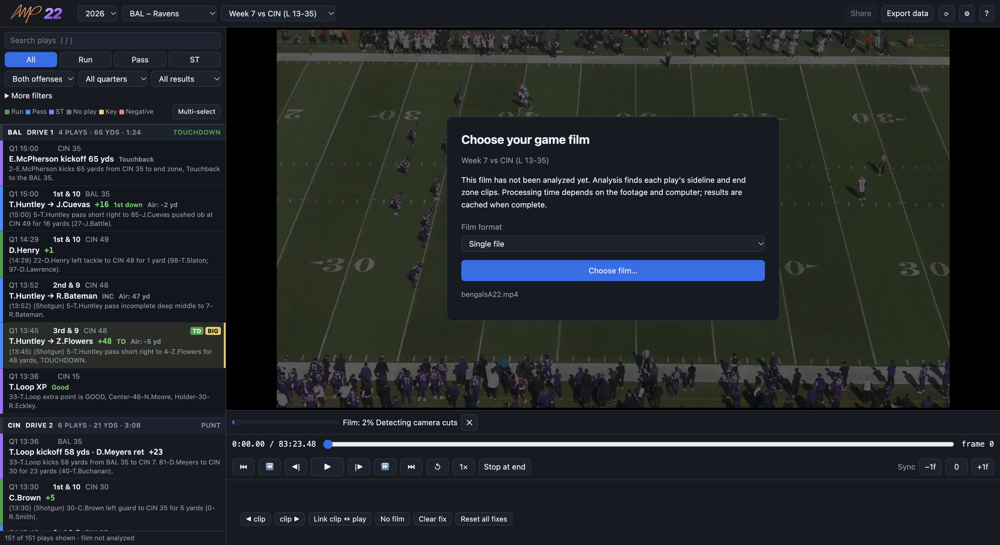

# AMP22

<p align="center">
  
</p>
<p align="center">
  <strong>Synced All-22 film study for macOS and Windows.</strong><br />
  <a href="https://github.com/apulianas/AMP22/releases/latest">Download the latest release</a>
</p>

AMP22 is a desktop app for macOS and Windows for studying NFL All-22 (A22) film. It plays the sideline and end zone angles of each play side by side, kept in sync. You can jump to any play from the nflverse (nflfastR) play-by-play and step through the film frame by frame.

**Study the players, not just the play result.** Capture a whole game's on-field participation with the optional NFL Pro browser extension, then let AMP22 import the CSV automatically while you study. Find plays featuring combinations of players with live matching-play counts, team-grouped filters, and ordered on-field rosters. See clearly marked depth-chart estimates for offensive-line positions, and export participation alongside box counts, pass rushers, EPA, and other available play data for analysis in Excel—even without loading film.

[Install the optional NFL Pro extension for Chrome, Edge, or macOS Safari](#optional-nfl-pro-browser-extension). An NFL Pro subscription and permission to collect its data are required for capture; the desktop app and its other data sources work without the extension.

## Screenshots

### Synced sideline and end zone

Browse color-coded plays and drive summaries while watching both angles together. The glossy toolbar wordmark blends into the UI without a black badge. Frame stepping, playback speed, and sync-offset controls sit below the film, with the selected play's result and charting tags. **Film setup** stays in the viewer's lower-right corner for changing files without a separate film-selection bar. This running-app capture uses the supplied 2026 Jaguars at Ravens single-file All-22, real play-by-play, and imported NFL Pro participation. Analysis at a `0.03` cut threshold recovered 148 film pairs; the selected first-quarter play shows both actual angles at Baltimore's 21-yard line.


### Choose film in the viewer

Select **Single file** and click **Choose film…** directly in the empty video area. The setup panel gets out of the way when analyzed film is ready; analysis progress appears below the viewer so completed split-film sources can be watched while others finish. This running-app capture uses real 2026 Bengals at Ravens play-by-play before assigning film.


### Split offense, defense, and special teams

Choose **Split offense / defense / ST** in the viewer's setup panel to assign three files. Offense and defense refer to the team selected above; each file contains both camera angles and aligns independently. This is the running app with real Bengals at Ravens play-by-play, before film selection—not a playback or alignment demonstration.


### Single-file analysis progress

The progress strip stays below the viewer and offers cancellation without a blocking dialog. This running-app capture shows an actual scan of the supplied 83-minute Bengals at Ravens A22 file, with **Single file** selected. The underlying raw film is open, but no play links are available until the entire file finishes; this is not progressive single-file alignment or a three-file import. Separate unit recordings were not supplied, so this capture does not demonstrate split-file readiness.



### Filters and charting

Combine offense, play type, result, and air-yards filters with the available quarterback alignment, motion, play-action, box-count, pass-rush charting, and **On-field players** filter. **Add player** lists only players appearing in plays that match the other active filters: Jacksonville offense, for example, offers actual Jaguars offensive participants and Ravens defenders in that subset, not the whole game roster. Each option shows **(N plays)**: how many plays would match if you added that player alongside everyone already selected. Counts update immediately when players or other filters change, and count each play once. Players with zero matching plays are hidden from the dropdown; removing a selected player restores any newly compatible options without clearing the remaining tags.

The dropdown groups the **team being analyzed first**, followed by the opponent, even when the offense filter selects the other team. Names are alphabetical within each team by default; **Settings → On-field player dropdown order** also offers matching-play and position ordering.

Select players to add name tags; the play must include **all selected players together** on either side. Each tag's **×** removes just that player; removing the last tag clears the player filter. Selected tags remain visible and removable if other filters exclude their plays, rather than silently clearing a selection. This sidebar capture from the running app uses actual 2026 Jaguars at Ravens play-by-play, filtered to Jacksonville offense with Kyle Hamilton and Brian Thomas Jr. together: **14 matching plays**. The persistent NFL Pro indicator confirms all 148 plays imported with complete player lists, using a subscriber's captured CSV.


### Ordered players on the field

Expand **Players on the field** below the viewer. Offense is ordered **WR, RB, FB, TE, eligible extra OL, QB, LT, LG, C, RG, RT**; defense is ordered **DE, DT, OLB, ILB, CB, safeties**. NT groups with DT and MLB with ILB, without changing their listed labels. Players within a group are ordered by jersey number. Generic or unusual listed positions remain visible rather than being guessed.

For generic offensive T/G/OL positions, AMP22 uses published nflverse depth charts to infer compatible left/right roles by **team and GSIS ID**. An asterisk, such as **LT***, marks a depth-chart estimate—not confirmed alignment on that snap. Hover over the position for its source, snapshot date, and original listed position. Modern charts use the latest snapshot on or before the game's date; older charts use the exact season, week, and game type. Equally ranked left/right assignments remain generic. Explicit source LT/LG/C/RG/RT positions are never replaced. Charts are downloaded automatically when needed, cached for offline use, and failures produce a data warning while retaining listed positions.

An eligible extra lineman appears as **OL-E** between TE and QB only when the play description explicitly reports that offensive lineman eligible, uniquely matched by jersey number, and the on-field list contains at least six linemen. A depth chart or an extra lineman alone does not establish eligibility. This running-app capture uses the actual Jaguars–Ravens Q1 10:31 play: Carson Vinson is explicitly reported eligible, while the other linemen's asterisks distinguish chart-derived sides.


### CSV analysis without film

**Export data** saves filtered, selected, or all game plays, with all available statistics and participation. Choose one row per play or one row per player per play. This is the actual export dialog in the running app with real 2024 Bills at Ravens data; an independent player-row CSV was exported successfully without loading film. It does not demonstrate live NFL Pro collection.


### Multi-play clip export

Export selected plays as sideline, end zone, stacked portrait, or all sideline followed by all end zone (and the reverse) in one video. Trim clip starts with per-play first-frame previews, set an overlay duration, or choose a clean export. Choose a team theme, customize its colors and background opacity, and save named themes or a new default. Position the overlay with corner presets, drag it on the export preview, and save named locations. Share also offers a CSV, plain-text, or team-colored PDF play breakdown, with optional advanced statistics. This running-app capture shows the theme and position controls with a top-right Ravens card. It uses a simulated field and illustrative play because game film was unavailable; it does not demonstrate real game alignment or a completed export.


### Overlay theme examples

These examples use AMP22's actual overlay renderer with a simulated field and illustrative play, not game film. Ravens, Chiefs, Eagles, and Bengals presets use dark team-colored panels with contrasting text. The custom light theme and 40%-opacity Ravens example demonstrate editable colors and transparency; text remains opaque and outlined.


### PDF play breakdown

PDF writeups include available player headshots alongside each play, including when the accompanying video uses **Clean export** or zero overlay duration. This is the first page of an actual two-play PDF exported from the running app with the supplied Bengals at Ravens film, showing Derrick Henry's headshot and real play-by-play and charting.


### Settings and shortcuts

**On-field player dropdown order** offers **Alphabetical** (default), **Most matching plays first**, or **Position, then most matching plays** within each team group. Play counts sort highest first and update with active filters and selected players; ties are alphabetical. Position sorting follows the offensive and defensive position sequences described above, with specialists and unknown positions last. Compatible depth-chart estimates appear with an asterisk; a player's reported-eligible snap does not turn eligibility into their overall dropdown position. Saving applies the order immediately and preserves it across restarts without changing selections or reanalyzing film. This crop from the running app shows the default alphabetical preference.


Customize playback, clip-start trimming, overlay duration, and play-breakdown defaults, including the report format, whether advanced statistics are enabled, and exactly which fields to include. This running-app crop focuses on report defaults, including player IDs, names, positions, jersey numbers, and participation provenance. The participation import folder is configured above this section; key-play definitions and keyboard shortcuts remain below it.


### Update notifications

See the latest published release notes before opening the download page. This is the running app checking a real GitHub release; installation remains manual.


## Features

- **Two synced angles.** Each A22 file contains sideline followed by end zone for each play. The app finds the cuts, pairs the angles, and plays them together on one clock. Use **Single file** for continuous full-game film, or **Split offense / defense / ST** for separate offense, defense, and special-teams files. In split mode, offense means the selected team's offense and defense means that team defending; the special-teams file covers kicks and returns by either team. Each file aligns independently, and selecting a play switches both viewers to the appropriate source. You can load only the files you have; the other plays remain unlinked. File choices and corrections are remembered per game and team perspective, separately from single-file film. The layout switches between side-by-side and stacked depending on the window shape.
- **Multi-monitor viewing.** After film analysis, click **Pop out** on either angle to open it in a separate window. Drag that window to another display and maximize it or click **Fullscreen**. The remaining angle fills the main viewer. Playback, seeking, frame stepping, speed changes, sync offsets, and play navigation still use the same controls and clock; keyboard shortcuts also work in the pop-out. Click **Return angle** in either window, or close the pop-out, to restore the two-angle layout. One angle can be detached at a time.
- **Background split-film analysis.** Offense, defense, and special-teams files process concurrently through one shared, CPU-aware worker limit (one to four media processes). Each completed file becomes usable without waiting for the other units; arriving results preserve playback of an already-ready source. The progress strip below the viewer shows each unit's status, and **Cancel** stops all unfinished analyses while retaining completed results. Unfinished sources are identified as still processing when selected. A single full-game file still requires its complete scan and classification before play links become available; partial single-file alignment is not enabled.
- **Play-by-play navigation.** Pick the season, team, and week from the drop-downs. The default is the current season, the Ravens, and the most recently completed week. Plays come from [nflverse](https://github.com/nflverse/nflverse-data) and are color-coded:
  - **Run** is green, **pass** is blue, **special teams** is purple, and **no play** (penalty) is gray.
  - **Key plays** get a gold edge and badges: INT, FUM, TOD (turnover on downs), TD, FG, SAF, 2PT, BIG (run ≥ 10 or pass ≥ 20 yards), 4TH (4th-down conversion), and optionally SACK.
  - **Negative plays** get a red edge and a SACK or LOSS badge. These are sacks, plus runs and completions that lose 3 or more yards.
  - You can change the key-play and negative-play definitions in Settings.
  - Plays are grouped by drive. Each drive has a header showing the team, number of plays, yards, time of possession, and result.
  - Each play shows a box-score line first, for example `T.Huntley → Z.Flowers +48 TD`, with the full play description below it in smaller text.
  - The list can be searched and filtered by play type (run, pass, special teams), offense, quarter, and result. Result filters: key, negative, sacks, turnovers, scores, big plays, first downs, penalties. The quarter list includes OT only when the game went to overtime.
  - Expand **More filters** below the offense/quarter/result controls to enter an inclusive minimum (`Air yards ≥`) and/or maximum (`Air yards ≤`). Leave either field blank for no limit; zero and negative bounds are supported. These filters combine with the other controls, and plays stay in game order with drive headers. Collapsing the section keeps its filters applied and shows an active indicator; clear both fields to remove the air-yards filter. Plays without air yards (such as sacks and runs) are excluded only while a bound is set, not treated as zero.
  - Air yards measure pass depth from the line of scrimmage, excluding yards after catch; throws behind the line have negative values. Available values appear beside the play result, including on incomplete and intercepted passes. Historical coverage varies. Previously downloaded play-by-play is reprocessed automatically to include air yards.
  - **More filters** also has inclusive **Yards gained** bounds (runs and passes only; kickoffs, punts, and no-plays are excluded while a bound is set) and **Yards to go** bounds, plus a **Down** selector. The indicator shows how many of these filters are active.
  - **Personnel and charting.** When nflverse has advanced data for the game, more filters appear under **More filters**. Only filters with data for the loaded game are shown, and all apply to runs and passes only:
    - From [FTN charting](https://github.com/nflverse/nflverse-data/releases/tag/ftn_charting) (2022 onward, updated during the season): QB alignment (shotgun, under center, pistol), backfield count, box count, motion, play action, RPO, screen, no-huddle, and, on dropbacks, pass rushers and blitzers.
    - From [participation data](https://github.com/nflverse/nflverse-data/releases/tag/pbp_participation) (2016 onward, published after each season ends, so not available for the current season): offensive personnel (RB count then TE count, e.g. `11`, `12`, `21`), defensive package, formation (before 2023), coverage (Cover 0/1/2/3/4/6/9, 2-Man…), and man/zone.
    - Defensive packages are derived from the number of defensive backs: four DBs are labelled by their front (`4-3`, `3-4`), five are **Nickel**, six **Dime**, seven or more **Quarter**, and three or fewer **Goal line**. Each label also shows the DL-LB-DB count (for example `Nickel 2-4-5`).
    - Play rows show personnel as `12 v Nickel`. The play details below the video list every personnel and charting tag, and **Players on the field** lists both sides' players in position order (jersey numbers from 2023 onward). Compatible depth-chart left/right offensive-line estimates are marked with an asterisk, with source/date tooltips; ambiguous positions remain generic. Explicitly reported eligible extra linemen appear between TE and QB. Search also matches these tags, for example `nickel` or `play action`.
    - Each season's files (about 10–50 MB) are downloaded once and cached for offline use.
  - **Local NFL Pro participation imports (experimental).** The optional WebExtension's **Capture game & save CSV** button fetches the game's unfiltered NFL Pro playlist and participation for every returned play, then automatically requests the CSV download. No manual play navigation or separate export click is required. AMP22 checks `nflpro-*.csv` in your Downloads folder by default, imports matching plays when loading a game, and watches for new files while running. A persistent sidebar indicator shows imported-play counts across the entire open game, complete/partial counts, and the last automatic update or check; filtering does not change these counts. Updates preserve the current play, selections, and loaded film. No manual refresh is required. Choose another folder or disable imports in **Settings → Participation CSV folder**. It verifies game metadata and play situations, never joins by list order, and reports invalid files, ambiguous matches, and unavailable folder watching in the indicator. Historical participation and FTN charting remain available; partial imports do not displace complete historical sides, and more complete captures are preferred over partial ones. Imported participation is labelled complete or partial per play; this is not a whole-game coverage claim.
  - **Player filtering and inferred personnel.** **More filters → On-field players** supports multiple players as removable name tags. Only plays with all selected player IDs on the field together match, across either side—not just the passer, receiver, or players mentioned in the description. Choose **Add player…** to add another, or use a tag's **×** to remove that player. Options follow all other active filters, using actual snap participation rather than a roster's listed offensive/defensive positions. Each option's **(N plays)** count predicts the combined result of adding that player; counts and available options update when selected players or other filters change. Candidates with zero matching plays are hidden and reappear when compatible again. An empty subset disables the picker with an explicit message; existing tags stay removable and are not silently cleared. Removing all tags restores unrestricted player matching. Player selections survive participation refreshes while those players remain available in the game, and filtered CSV exports use the same combined filter. Search also matches on-field names, positions, and jersey numbers. Complete eleven-player sides with known positions can supply missing offensive personnel or defensive package labels. An asterisk and detail tag identify inferred values; listed positions do not establish actual alignment. Supplied personnel is not overwritten, and inferred values are exported separately.
- **Independent analysis CSV.** **Export data** works without film and exports filtered, selected, or all plays in game order. Every available advanced field is included, regardless of Share's report preferences. **One row per play** includes parallel semicolon-separated player lists; **One row per player per play** includes individual player identity, team, side, original position, and jersey number alongside repeated play statistics. Depth-chart position estimates, their sources and snapshot dates, and explicitly reported eligibility are separate fields; original positions are never overwritten. An empty **Reported eligible** field means not identified, not confirmed ineligible. Both layouts include nflverse game/play IDs and available participation provenance and inference fields. Plays without participation retain a blank-player row. Missing statistics stay blank, while zero and **No** remain distinct.
- **Frame-accurate controls.** Step 1 frame or N frames at a time (N defaults to 10 and is configurable). You can also move to the next or previous play, restart the play, and change to slow-motion speeds. At the end of a play the app can stop, auto-advance, or loop.
- **Clip export.** Click a play and then **Share** to export its sideline angle, end zone angle, or both. Shift-click another play to select the visible plays in between, or turn on **Multi-select** to choose individual plays. Checkboxes are hidden during normal single-play browsing. Selected plays are joined into one MP4 in game order, even when selected out of order. Both angles are stacked in a 1080×1920 (9:16) portrait video; the original layout places the play's clock, down/distance, box-score result, badges, and description below, without camera-angle labels over the footage. Single-angle exports are 1920×1080 with a compact result card. Choose a corner preset or drag the card on the export preview, save named locations, and make any location your default. Custom and corner positions use a compact card over centered footage in portrait output. **All sideline, then all end zone** and **All end zone, then all sideline** produce one 1920×1080 MP4, with all selected plays in game order within each angle block. Trim starts independently per play using decimal seconds and preview the first retained frame of the selected angle or angles. Overlay duration is configurable for every layout, measured from each trimmed clip start. Settings remembers the user's trim and overlay defaults locally. Exports use normal speed and saved sync offsets, with audio from the selected angle (sideline for stacked portrait). Playback and original film are never modified.
- **Ordered play breakdowns.** Share can save a **CSV spreadsheet**, **plain text**, or **PDF** alongside the video, with one entry per video clip in exactly the same order—including exports spanning split files. Grouped-angle exports repeat the selected plays for the second angle block. Reports identify the matchup and include each play's clip number, game play ID, quarter/clock, offense/defense, play type, down/distance, field position, yards, result, and description. PDFs use the selected team's colors, team-colored play cards, a run/pass/special-teams summary, and page numbers. **Include advanced statistics** adds the fields selected in Settings: air yards, personnel/packages, formation, QB alignment, backfield/box counts, motion, play action, RPO, screen, no-huddle, pass rushers/blitzers, coverage, and man/zone. Missing data stays blank in CSV and is marked **Not available** in text/PDF; zero and **No** remain distinct from missing values. The default is **CSV without advanced statistics**. Settings lets you customize the format, advanced-statistics default, and individual fields; Share lets you override the format and toggle advanced statistics for the current export or choose **No breakdown**.
- **Update notifications.** Installed macOS and Windows builds check GitHub for a newer stable release at startup. The prompt shows your version, the latest version, and its published changelog. **Open download page** opens that release in your browser; choose the macOS DMG or Windows installer and install it manually. **Later** suppresses startup prompts for that version, but the **Update available** button stays accessible and newer versions can notify again. If playback, export, or another dialog is active, the button appears without interrupting your work. **Settings → Check for updates…** always lets you check again, including in development builds. Network failures are shown in Settings and can be retried.

## Getting started

For packaged releases, choose the **arm64 DMG** for Apple Silicon Macs (M-series), the **x64 DMG** for Intel Macs, or the **Windows installer**. Each installer includes the video-processing tools it needs. Apple Silicon Macs currently need Rosetta 2 for the bundled Intel FFprobe helper; the app and FFmpeg are native arm64. Intel builds run both helpers natively.

Requirements: Node.js 20 or later.

```sh
npm install
npm start
```

npm 11 blocks install scripts unless they are approved. The `allowScripts` entry in `package.json` approves the scripts for `electron`, `ffmpeg-static`, and `ffprobe-static`. If the Electron binary is missing, run `node node_modules/electron/install.js`.

### Using it

1. Choose the season, team, and week. The schedule and play-by-play are downloaded and cached, so games you've opened before also work offline.
2. In the empty video area, leave **Single file** selected and click **Choose film…** for full-game A22. For separate units, select **Split offense / defense / ST**, then use **Choose [team] offense…**, **Choose [team] defense…**, and **Choose special teams…** in the same panel. Each file must contain both angles, not one camera per file. Select the team whose offense/defense the files describe before assigning them. The app streams files from where they are and never copies or changes them. After loading analyzed film, use **Film setup** in the viewer's lower-right corner to change files or formats; close the panel to return to the footage. Selecting a play whose split-film source is missing reopens setup so you can assign it.
   In single-file mode, you can also set a **film folder** in Settings (⚙), for example `~/Movies/2026 Ravens Games`. The app then finds the A22 file automatically by matching week folders such as `w7vBengals` or `w1@Colts` and preferring files with `a22` in the name. Split files are assigned explicitly, not guessed from filenames.
   The app remembers the format and file choices. Switching formats preserves both sets of choices and their corrections.
3. The first time you open film, the app analyzes each selected file. Processing time depends on the footage and computer; the experimental worker/thread limits currently regress single-file performance in the [home-machine profile](#home-machine-profile), so do not assume faster processing or a fixed completion time. Split files process concurrently, with each unit's progress shown below the viewer. Start watching a completed unit immediately while other units finish. Setup can be reopened and dismissed without stopping analysis. **Cancel** stops all unfinished files; completed film stays available, and **Analyze film** retries unfinished files. Single-file play links become usable after that whole file finishes. Results are cached by file path, size, and modified time.
4. Click a play, or use ↓/↑, to watch it.
5. To save a clip, click **Share**, choose an angle, and click **Export…** to pick an MP4 destination. Single-play filenames use `TEAM-POSSESSION-PLAY NUMBER-DOWN-DISTANCE.mp4` (for example `BAL-O-12-2-7.mp4`). Team is the selected analysis team; possession is `O` (offense), `D` (defense), or `ST` (special teams) relative to that team. The play number is its one-based position in the game's play list, unaffected by filtering or film links, not the data provider's play ID. Unavailable possession, down, or distance uses `NA`. Multiple plays still use only the game-clock range (`Q2-08m34s-to-Q3-04m12s.mp4`). Single-angle results use a compact card sized to its text rather than a full-width banner, positioned in the lower left by default. Shift-click to select a range, or use **Multi-select** and checkboxes for individual plays. Selected plays remain selected when filtering; the selection count includes hidden plays. A normal row click outside explicit multi-select mode, or navigating to another play, returns to a single selection and hides the checkboxes. Turn **Multi-select** off to return to a single selection. Plays without linked film must be deselected or linked before export. Export progress and cancellation are available in the Share dialog. After export, **Show in Finder** (macOS) or **Show in File Explorer** (Windows) opens the containing folder with the exported file selected.

**Multi-select** sits beside the color legend below the filters. The selection count and **Clear selection** appear only while multi-select is active or more than one play is selected, leaving more room for the play list during normal browsing.

Under **Trim clip starts**, select each play to inspect the first retained frame of the selected export angle. Portrait and grouped-angle exports show both angle previews. **Remove from this play (seconds)** accepts decimals such as `1.25` and applies the same trim to both synced angles. Every selected play starts with **Settings → Clip export defaults → Trim from each clip start**, initially `0`. Per-play overrides apply only to the current Share dialog; reopening Share starts from the remembered default. A trim that would remove an entire clip blocks export and identifies the play to adjust. This is fixed-time trimming, not automatic snap detection.

**Overlay duration** also accepts decimals and applies from the trimmed start of every clip, including each angle block in grouped exports. Set its remembered default in **Settings → Clip export defaults** (initially `3` seconds), or override it in Share for the current export. A value of `0` hides the overlay; a duration longer than the clip shows it throughout. With **Original layout**, portrait exports keep the reserved lower panel after its play details disappear; use a corner/custom location or **Clean export** to center the footage instead.

Under **Overlay position**, choose **Top left**, **Top right**, **Bottom left**, or **Bottom right**, or drag the card directly on the first-retained-frame export preview. The **Horizontal position (%)** and **Vertical position (%)** sliders also allow precise, keyboard-accessible positioning. The whole card stays within the output frame. Corner and custom positions use a compact result card in every layout; portrait footage is centered rather than reserving the original description panel. Grouped-angle previews show the first angle block, and the chosen location applies to both blocks and every selected play. The preview includes available headshots and respects clean exports and zero overlay duration; the separate trim previews remain overlay-free.

Under **Overlay theme**, **Automatic** defaults to the team selected for analysis, not the team possessing the ball on each play. Presets cover every NFL team, including the historical Oakland, San Diego, and St. Louis names. Choose any team or saved theme, then tweak **Background** and **Accent** to create a custom version. Text automatically switches between black and white for contrast and has an opposite-color outline; panels also have a contrasting border to separate them from green turf. **Background opacity** ranges from `0%` (transparent panel) to `100%` (opaque), initially `90%`. Text, accent stripes, borders, and headshots stay opaque; very low opacity reduces panel contrast. Preview and exported video use the same colors and opacity in every layout, including the original portrait information panel. The portrait layout's reserved backdrop remains after the overlay disappears.

Enter a theme name and click **Save / replace theme** to keep its colors locally; the same name replaces an existing saved theme without changing the built-in preset. **Make theme / opacity default** remembers the current colors and opacity for future Share dialogs and app restarts. To restore team-following behavior, select **Automatic** and make it the default. Saving a named theme alone does not change defaults or save opacity with that name. **Delete saved theme** leaves current colors and defaults unchanged. Theme and opacity controls are disabled for clean exports, and video themes do not change PDF report colors.

Enter a name and click **Save / replace location** to keep a location in the Location menu; saving the same name replaces that location. Choose **Make default** to use the current preset or custom position whenever Share opens, including after restarting AMP22. Saving a location alone does not change the default. **Delete saved location** removes the selected named preference without changing the current position or default. Positions are stored locally as relative coordinates, so they adapt to different card sizes and landscape/portrait output. **Original layout** restores the original lower-left landscape card or full portrait information panel and remains the default until you explicitly change it.

For grouped-angle output, choose **All sideline, then all end zone** or **All end zone, then all sideline** under **Camera angle**. For plays A, B, and C, the first option exports sideline A/B/C followed by end zone A/B/C, not alternating angles per play. Each segment uses its own angle's audio and the play's trim override, including selections spanning split files.

Under **Play breakdown**, choose **CSV spreadsheet**, **Plain text**, **PDF · team colors**, or **No breakdown**, and optionally enable **Include advanced statistics**. A video named `clips.mp4` gets a companion `clips-plays.csv`, `clips-plays.txt`, or `clips-plays.pdf` in the same folder. AMP22 asks before replacing an existing breakdown. If the video saves but the breakdown cannot be written, Share reports that partial failure explicitly and still lets you reveal the saved video. **Settings → Play breakdown defaults** controls the defaults and advanced-field selection; these settings do not change clean/overlay video behavior.

PDF play cards include available headshots using the same primary-player rules as video overlays. Photos are embedded in the PDF, so viewing the saved writeup requires no network connection. Headshots remain in the PDF even with **Clean export** or an overlay duration of `0`; CSV and plain-text breakdowns remain text-only.

Enable **Clean export (no overlays)** in the Share dialog to omit all added text, graphics, and play details for either single- or multi-play exports. Both-angle exports remain 9:16, with the stacked footage centered on a black background instead of reserving a bottom panel for play information. Overlays remain enabled by default.

Overlays and PDF writeups include a headshot matched by the play-by-play's GSIS player ID: the runner, the receiver on a completed pass, or the defender credited with an interception, lost-fumble recovery, or sack. Transparent padding is trimmed so the player fills the headshot area, with the original alpha channel preserved and no photo background or outline. Turnovers take priority over sacks and offensive players; shared sacks use the first credited defender. Nullified plays and incomplete passes do not show an offensive headshot. Headshots and the nflverse player directory are cached for offline use. If a photo cannot be found or downloaded, the export keeps its text overlay and PDF writeup and reports a headshot notice instead of guessing a player. Clean exports do not request headshots unless a PDF breakdown is selected.

Export overlays describe rushing and receiving yardage as `12 yard rush` or `48 yard reception`, without a plus sign; losses retain a minus sign (for example `-3 yard rush`). Touchdown rushes and receptions still include `TD`. The compact box-score wording in the play list is unchanged.

Player participation lists, source metadata, inferred personnel, depth-chart position estimates and their provenance, and reported eligible player IDs are also selectable under **Settings → Play breakdown defaults** for Share's CSV/text/PDF reports. These additions do not change the default of CSV without advanced statistics. **Export data** always includes supported advanced fields, including EPA, independently of those preferences.

### Optional NFL Pro browser extension


The extension uses a simplified AMP22 logo without field lines or glossy effects, with dedicated small-size PNGs for the Chrome, Edge, and Safari toolbar.

To regenerate these assets from the app's signature and extension's flat-icon template, run `npm run build:extension-icons`, then `npm run build:extension`. The checked-in PNGs are included in extension builds without requiring icon generation on the user's machine.

Collection requires NFL Pro access and permission to collect the data. The extension does not sign in for you, bypass access controls, fetch film, or upload data. It uses the signed-in page's own API client to request the unfiltered game playlist and each play's home/away participation summary, without changing the current video or filters. A subscriber's live 148-play capture has been verified through CSV import; authenticated capture and download in each of Chrome, Edge, and Safari have not yet all been verified. The adapter also has automated fixture coverage.

#### Download the extension

Open the [latest AMP22 release](https://github.com/apulianas/AMP22/releases/latest) and download **AMP22-NFL-Pro-Extension.zip** from **Assets**, separately from the desktop app installer. Extract the ZIP for Chrome or Edge; the folder you load must directly contain `manifest.json` and `participation.js`. Safari's temporary loader also accepts the ZIP.

If you are building from source instead, run the following in the repository and use the generated `out/nflpro-extension` folder—not the source `extensions/nflpro` folder:

```sh
npm run build:extension
```

#### Install in Chrome (macOS or Windows)

1. Open `chrome://extensions` in the address bar.
2. Enable **Developer mode**, click **Load unpacked**, and select the extracted folder containing `manifest.json`.
3. Open Chrome's **Extensions** toolbar menu and pin **AMP22 NFL Pro Participation** for easy access.
4. Open your signed-in NFL Pro game and reload its page before capturing.

#### Install in Edge (macOS or Windows)

1. Open `edge://extensions` in the address bar.
2. Enable **Developer mode**, click **Load unpacked**, and select the extracted folder containing `manifest.json`.
3. Open Edge's **Extensions** menu and show **AMP22 NFL Pro Participation** in the toolbar.
4. Open your signed-in NFL Pro game and reload its page before capturing.

Chrome and Edge developer installs do not require a store account or signing. Keep the extracted folder in a stable location; removing it breaks the unpacked installation. After replacing the files with an updated release, click the extension's **Reload** control on the extensions page and reload the NFL Pro tab.

#### Install temporarily in Safari (current macOS)

1. Enable **Safari → Settings → Advanced → Show features for web developers**.
2. Open **Settings → Developer → Add Temporary Extension…** and select the downloaded ZIP or extracted extension folder.
3. Accept the unsigned-extension prompt, enable **AMP22 NFL Pro Participation**, and allow it on NFL Pro when prompted.
4. Open your signed-in NFL Pro game, reload its page, and use the extension's toolbar button.

**No paid Apple developer account or Xcode project is required for this temporary loading route.** Safari removes temporary extensions after 24 hours or when Safari quits; add the extension again when needed. This is not a persistent App Store installation or iOS support. If your Safari version lacks **Add Temporary Extension**, update Safari or use Chrome/Edge; older Safari requires an Xcode wrapper for local development. See [Apple's unsigned/temporary extension instructions](https://developer.apple.com/documentation/safariservices/running-your-safari-web-extension). Safari's download fallback is implemented, but its complete authenticated capture/download flow has not yet been live-verified.

#### Capture a game and automatically import it

1. In AMP22, open **Settings → Participation CSV folder → Choose…**, select your browser's download folder (or another folder where you will save the capture), and save Settings. Open the game you want to study.
2. In your browser, open that single game's page at `pro.nfl.com/film/plays` while signed in with NFL Pro access.
3. Click the extension's toolbar button, then **Capture game & save CSV** once. You do not need to visit each play or advance through the film.
4. Keep the NFL Pro tab open until capture finishes. Approve any download prompt and save `nflpro-<season>-<game-id>.csv` into the folder configured in AMP22, keeping the generated filename.
5. AMP22 imports the completed CSV automatically, even if the app was already open. For a matching game, the sidebar shows the imported play counts and an **Updated automatically** confirmation; no manual reload is needed.
6. Use **More filters → On-field players** to combine players, or **Export data** to save play-row or player-row CSVs for further analysis.

The extension requests the game's full, unfiltered playlist, verifies its returned count, and sequentially retrieves participation for every play—including plays you have never visited. It spaces requests, retries temporary server errors and rate limits, and stops on access errors. The popup shows progress and offers **Cancel**. Closing the popup does not stop capture, and reopening it restores progress. Changing the game or reloading the page interrupts the job.

Each request has a 15-second timeout and up to three attempts for HTTP 429, 500, 502, 503, and 504 or recognized network/timeout errors. Retries wait two then four seconds unless the server supplies `Retry-After`; a requested pause longer than one minute stops capture. Authentication failures and malformed participation are not retried: repeatedly fetching the same invalid field does not repair its format.

If capture fails, the message identifies an invalid field, its safe diagnostic value, the source play ID, and player-row number. **Save diagnostics** downloads a JSON report with the extension version, game ID, failure stage, validation details, and the last 200 request/retry events. Attach that report when reporting a problem rather than sharing a HAR or raw API response. Diagnostics exclude credentials, cookies, request headers, raw responses, player names, descriptions, and filesystem paths. Reports are also available after a completed capture. Reload both the extension and NFL Pro tab after updating so the current diagnostics code is active.

Player identity prefers NFL Pro's NFL player ID when present; a blank optional NFL ID falls back to the available GSIS ID. Missing both identities remains an explicit validation failure rather than an invented player ID.

NFL Pro's zero-down marker (`0`, displayed as `--` on its site) is exported as a blank down, not a fictional “zeroth down.” Valid downs 1–4 and legitimate zero distance remain unchanged. Other invalid values still stop capture with diagnostics.

After every listed play has valid participation, the extension automatically requests `nflpro-<season>-<game-id>.csv`. It does not save a success-looking partial CSV if the playlist is truncated or duplicated, or a play's participation is missing or invalid. A complete sweep covers NFL Pro's returned game playlist, not necessarily every timeout, penalty, or other event in nflverse; individual player lists may still have fewer than eleven players per side. Capture data stays in memory until export; extension storage keeps progress metadata, not player records.

AMP22 verifies game and play situations rather than assuming the providers' play IDs are interchangeable. Kickoff descriptions distinguish them from extra points at the same clock time: NFL Pro labels the kicking team as offense, whereas nflverse assigns possession to the receiving team. Imports align player sides with nflverse's teams, so app analysis exports retain the correct player/team association. This does not change play classification: CSV **Play type** remains `kickoff` or `extra_point`, and both remain special teams in filters and the `ST` video-filename label. Description matching also normalizes jersey-number prefixes and NFL Pro's `BLT` abbreviation for Baltimore. Unresolved or colliding matches still produce a data warning rather than guessing.

Chrome and Edge use the browser Downloads API. Safari, which does not support that API, requests a Blob download from the page; its actual download behavior still requires live verification. Approve any browser download prompt and check Downloads. Browser download settings determine the actual location; the extension cannot silently select an arbitrary filesystem path. Keep the generated filename and choose the same folder in AMP22 Settings. AMP22 imports the completed CSV automatically when that folder matches. With the matching game open, the sidebar shows the imported count and **Updated automatically** confirmation; an unrelated game's download triggers only a check, not a claimed data update. Before any matching import, it shows that it is watching for CSVs. Save before quitting Safari; temporary-extension storage is not a backup of the CSV.

For Excel analysis, click **Export data**, choose the scope and row layout, then **Save CSV…**. Player-row exports repeat play-level values such as yards, box count, and pass rushers: deduplicate by **nflverse game ID + Game play ID** before summing those values. Use **GSIS player ID** for cross-source joins; unresolved imported players retain their separate **Source player ID**. The versioned import schema is defined in `src/shared/participation.js`; this provides a stable game/play/player foundation for future analysis tools.

### Keyboard shortcuts

Press **?** in the app to see the shortcuts. Hovering over a button also shows its shortcut. You can remap shortcuts in Settings.

| Action | Keys |
| --- | --- |
| Play / pause | Space, K |
| Forward / back 1 frame | → / ←, `.` / `,` |
| Forward / back N frames (default 10) | Shift+→ / Shift+← |
| Next / previous play | ↓ / ↑, N / P |
| Restart play | R, Home |
| Cycle slow-motion speed | S |
| End of play: stop / auto-advance / loop | E |
| Sync: end zone 1 frame earlier / later | `[` / `]` |
| Sync: reset offset | `\` |
| Browse film clips: next / previous | Shift+↓ / Shift+↑ |
| Fix: link shown clip to selected play | Shift+L |
| Fix: mark selected play as having no film | Shift+X |
| Fix: clear correction on selected play | Shift+C |
| Search plays | / |
| Shortcut help | ? |

### Fixing play ↔ film alignment

Plays are matched to film clips automatically. Most pre-snap penalties appear in the film, but the occasional one does not. When that happens, the app can't always tell *which* penalty is missing, so later plays may be off by one clip. To fix this:

1. Select the first play that shows the wrong film.
2. Press Shift+↓ / Shift+↑ (or use **◀ clip / clip ▶**) until the correct clip is shown.
3. Press **Shift+L** (**Link clip ↔ play**). The rest of the game re-aligns around this fix.

Other fixes:
- **Shift+X** marks a play as having no film.
- **Shift+C** clears a fix.
- **Reset all fixes** clears every fix for the game.

Fixed plays show a ✎ badge. If the two angles are slightly out of sync on a play, use `[` / `]` to shift the end zone angle one frame at a time. Fixes and sync offsets are saved per game. In split mode, clip browsing stays in the selected play's unit, so corrections never move a play into a different unit's file or shift the other units. Split corrections are scoped to the selected team and do not replace single-file corrections; **Reset all fixes** resets the active format/team perspective only.

## Settings

Settings include:
- Jump size N
- What happens at the end of a play
- Slow-motion speeds
- Default team
- Film folder
- Whether to analyze film automatically when it's opened
- Whether next/previous play skips plays without film
- Cut sensitivity
- Default clip-start trim and overlay duration in decimal seconds
- Play-breakdown format, advanced-statistics default, and individual advanced fields
- Key-play definitions
- Keyboard shortcuts

Data is stored in Electron's `userData` folder. AMP22 retains the original `A22 Film Tool` profile directory so existing settings, film links, fixes, and cached analysis remain available after upgrading. The application identifier is also unchanged for installer continuity.

| File or folder | Contents |
| --- | --- |
| `settings.json` | Settings |
| `games.json` | Film format, single/split file paths, and separate fixes/offsets for each game and split-team perspective |
| `updates.json` | Latest release version dismissed with Later or opened for download |
| `analysis/` | Cached film analysis |
| `cache/` | Downloaded schedule and play-by-play |

Participation imports remain in the configured external folder (Downloads by default); AMP22 reads them without modifying them. Keeping those CSVs preserves imported participation across restarts. Moving or deleting them removes that local source on the next game load or folder refresh.

### Updating AMP22

Open **Settings → Check for updates…** to see whether a newer stable version is available. Packaged apps also check once at startup (an internet connection is required). Release notes come from the public GitHub release and are displayed as plain text, not executable HTML. Automatic checks do not download installers or send your film, game data, or settings.

The download button opens the release page, not an unattended installer. After downloading, quit AMP22 before replacing the app on macOS or running the installer on Windows. Existing installations without this update checker need one manual upgrade to gain notifications. In-place automatic download/install is not enabled on either platform; the current macOS releases are unsigned, and reliable macOS auto-updates require Developer ID signing.

## How analysis works

1. `ffprobe` reads the frame rate (59.94 fps for A22) and duration.
2. `ffmpeg` scene detection runs on a 64×36 downscale to find hard cuts (default scene score ≥ 0.1). **Settings → Cut sensitivity** accepts thresholds down to `0.03`; lower values recover subtler angle changes but may also detect extra cuts. The initial scan respects the selected threshold rather than discarding weak candidates before pairing. If film clips are missing and the log drifts, lower the threshold and accept the re-analysis prompt. Existing cached analyses of other files remain unchanged.
3. Two small grayscale frames, at 35% and 65% of each clip, are classified as **sideline** or **end zone** by comparing vertical and horizontal edge energy. In end zone views the yard lines run horizontally. Both samples use one FFmpeg process per clip with independent timestamp seeks, rather than launching a separate process for each frame. Damaged clips retry individual samples and record warnings instead of silently discarding failures.
4. Clips are paired (sideline followed by end zone) with dynamic programming. This handles extra cuts and stray short clips.
5. Plays are aligned to the pairs with a second dynamic program. This step accounts for plays that are unlikely to be on film (such as non-play penalties) and for the user's fixes.

In split mode, the same analysis runs concurrently on each file and alignment runs independently on the appropriate offensive, defensive, or special-teams plays. Scans and sample extraction share a worker queue across files, with explicit FFmpeg thread limits to avoid multiplying unrestricted decoders. Turnovers stay with the unit that began the play; unclassified plays remain unlinked rather than consuming another unit's clip. Only complete file analyses are published and cached: whole-film orientation normalization, pairing, and play alignment have not been replaced by provisional prefix alignment.

The core logic is in `src/shared/` and has unit tests. You can also run the analysis from the command line:

```sh
npm run analyze -- "/path/to/TeamA22.mp4" --out analysis-out/team --frames 6
```

New analyses print probe, scan, classification, pairing, and total elapsed times, plus the worker limit. `analysis.json` includes the same `timings` in milliseconds and any sampling `warnings`. Times include worker-queue waits. For home-machine comparisons, run this command on the same film before and after the change with the same options and no competing exports; compare both total time and phase times. Previously cached analyses have no timing fields; the CLI performs fresh analysis unless `--from-json` is supplied.

### Home-machine profile

On November 6, 2026, the 0.5.0 baseline (`6bec5f3`, PR #14) and this experimental branch were profiled on the **same single** Bengals at Ravens full-game file: 4.75 GiB, 83:23.48, H.264, 1920×1080 at 59.94 fps. The machine was a 10-core Apple M1 Pro with 32 GiB RAM. Both runs performed fresh analysis at cut threshold `0.1`; there were no concurrent exports. The baseline's unchanged probe/scan/classify/pair functions were timed individually; the experimental run used the CLI above with its built-in timings.

| Phase | 0.5.0 baseline | Experimental branch |
|---|---:|---:|
| Probe | 0.11 s | 5.95 s |
| Scene scan | 225.76 s | 673.92 s |
| Orientation classification | 45.47 s | 70.79 s |
| Camera pairing | 0.002 s | 0.002 s |
| Total | **271.34 s (4m 31s)** | **750.66 s (12m 31s)** |

**No throughput improvement is demonstrated: this experimental run was 2.77× slower.** Its two-thread scene-scan cap is the leading suspect for the scan regression; batching also did not improve classification on this machine. These are exploratory single-pass measurements, not controlled repeated trials: native checks overlapped the experimental run's opening scan, the baseline ran afterward, and helper startup and OS-cache state were not controlled. Those differences should be controlled in follow-up measurements, but these results do not support claiming a speedup or promoting the processing changes as a performance improvement.

Both versions produced **identical 302 clips, orientation scores, and 150 camera pairs**, with zero experimental sampling warnings. The app linked 150 of 151 play-by-play entries automatically. Counts alone do not prove correct alignment: spot checks across all four quarters found an existing sequence-alignment mismatch near the Q1/Q2 boundary (the Q2 15:00 run at CIN 49 initially links to a BAL 36 formation). The shared pairing/alignment algorithms are unchanged from 0.5.0; use the existing **Link clip ↔ play** and **No film** corrections rather than treating every automatic link as verified.

In the running app, 12 play selections spread across the four quarters settled in **24–181 ms** (median **116 ms**). Warmed three-second playback samples at 1× and 0.25× reported no dropped frames in either viewer; maximum measured inter-angle clock difference was below 12 ms across the warmed samples. **0.5× was not consistently drop-free**: sideline dropped 4/94 and 12/93 frames in two samples, and end zone dropped 0/93 and 7/92. These short measurements do not certify every play or display configuration. Single-file progressive loading remains deferred; the complete file still finishes before automatic play links are published.

## Data sources

- Schedule: [nflverse `games.csv`](https://github.com/nflverse/nfldata/raw/master/data/games.csv)
- Play-by-play: `https://github.com/nflverse/nflverse-data/releases/download/pbp/play_by_play_{YEAR}.csv.gz`
- Player headshots: [nflverse player directory](https://github.com/nflverse/nflverse-data/releases/download/players/players.csv), using its NFL-hosted headshot URLs.
- Optional local participation: user-captured NFL Pro CSVs, imported alongside historical nflverse participation and FTN charting.
- Optional offensive-line position inference: published [nflverse depth charts](https://github.com/nflverse/nflverse-data/releases/tag/depth_charts), including modern timestamped ESPN charts and historical weekly charts. These describe depth-chart roles, not per-snap alignment.

## Development

Follow [the repository contribution instructions](AGENTS.md). User-visible PRs should update the relevant README features and usage, and refresh affected screenshots in `docs/screenshots/`; the PR template includes a checklist for this.

```sh
npm test           # unit tests (node:test)
npm run build:extension # shared unpacked Chrome/Edge/temporary macOS Safari extension
A22_TEST_EXPORT=1 npm test # also encode and inspect synthetic clips (macOS / Linux)
A22_TEST_MEDIA=1 node --test test/media.test.js # native batched-vs-individual sample parity and analysis timings
A22_TEST_WINDOWS=1 node --test test/angle-window.test.js # exercise native pop-outs (requires a desktop)
A22_TEST_WORKFLOWS=1 node --test test/film-workflows.test.js # native split playback and CSV/text/PDF exports (requires a desktop)
npm run dist:mac   # macOS .dmg   (run on macOS)
npm run dist:win   # Windows NSIS installer (run on Windows)
```

The bundled FFmpeg and FFprobe must run on the target platform. Install dependencies and build natively on each target platform: Apple Silicon macOS, Intel macOS, or Windows x64. Merely cross-targeting Electron does not replace the installed FFmpeg binary. The included GitHub Actions workflow (`.github/workflows/build.yml`) uses a matching native runner for each target, checks the packaged app/FFmpeg architectures, and executes the packaged media tools. The current `ffprobe-static` dependency supplies an Intel FFprobe even in its `arm64` directory, so Apple Silicon uses Rosetta 2 for that helper; Intel packages are fully native.

### Automatic builds and releases

Every merge (or push) to `master` builds separate Apple Silicon (`arm64`) and Intel (`x64`) macOS DMGs and the Windows x64 installer, then publishes them together on the repository's [Releases page](https://github.com/apulianas/AMP22/releases) once all three builds pass. The release version normally increments the highest stable Git tag (or the `package.json` baseline if there are no stable tags) by one patch; no version-bump commit is needed. To request a specific newer release, bump `package.json` and `package-lock.json` above all existing stable tags: that exact version is published without an extra patch increment. All installers use the same version. Rerunning a released commit reuses its version and replaces its assets. Builds on `master` are serialized to prevent competing release numbers.

Intel builds use `macos-15-intel` with Xcode 26 for the Icon Composer assets; native encoding tests run on both macOS architectures. GitHub has [scheduled its hosted Intel runner's retirement for August 2027](https://github.com/actions/runner-images/issues/13045), so continuing Intel builds after that will require another build host or a validated cross-build setup.

GitHub-generated release notes are also the in-app changelog. Edit a published release's description to refine those notes; subsequent update checks show the updated text. Keep production tags in stable `vMAJOR.MINOR.PATCH` form. Draft and prerelease versions are not offered by the update checker.

Pull requests build and test all three targets and upload workflow artifacts, but do not publish releases. You can also run the **build** workflow manually on `master` to retry a build or release.

### Experimental builds

To publish a testing build without promoting it to stable, run **Actions → build → Run workflow**, select the feature branch, and enable **experimental**. The workflow definition with this input must first be available on the default branch for GitHub to expose the dispatch form. All three native builds must pass before publishing. The version is suffixed with `-experimental.RUN_ID.RUN_ATTEMPT`; installers and the app are named **AMP22 Experimental**, use a separate application identifier, and save settings, film links, and caches in a separate **AMP22 Experimental** profile. Stable settings are not copied automatically. `A22_USER_DATA`, when explicitly set, overrides either profile.

Experimental releases are marked **Prerelease**, never **Latest**, and are not offered to stable users by the app's update checker. Download and install them manually from Releases; experimental builds still check only for stable updates, not newer experiments. Normal pushes to `master` still publish stable releases, so keep unapproved experimental code on its feature branch. An older experimental prerelease does not contain this rebased branch's profiling/documentation updates; the home-machine profile above is not a release or a claim that the performance regression has been fixed.

### Download counts

GitHub tracks downloads separately for each release asset, so the `arm64` DMG, `x64` DMG, and Windows installer have independent counts. No app telemetry is required. With the GitHub CLI, show the latest release's filenames and download totals:

```sh
gh api repos/apulianas/AMP22/releases/latest \
  --jq '.assets[] | [.name, .download_count] | @tsv'
```

For every published release, including older versions:

```sh
gh api --paginate repos/apulianas/AMP22/releases \
  --jq '.[] | select(.draft == false) | .tag_name as $version | .assets[] | [$version, .name, .download_count] | @tsv'
```

These are download totals, not unique people, installations, or active users. Counts belong to individual assets; deleting and reuploading an installer (including a release-build rerun that replaces it) resets that asset's count. Keep old assets or record snapshots if you need historical comparisons.

Development hooks for automation:
- `A22_USER_DATA=/dir` uses a different userData folder.
- `A22_DEV_SCRIPT=/file.js` loads a module and calls it with `{ app, win, analysisDir }` after the window opens.

### Branding and app icons

The AMP signature is the supplied vector artwork in `src/renderer/assets/amp.svg`, recolored orange (`#ff8a24`). The in-app toolbar wordmark has a transparent background so its orange AMP and purple 22 blend into the toolbar, without a black badge. Gradient highlights and subtle depth give the toolbar lettering a glossy, glass-inspired finish; the signature still uses the original vector shape. The app icon uses Icon Composer's glass rendering: two large purple (`#a970ff`) **2** numerals flank the signature's descending M-to-P stroke on a lifted charcoal-to-black gradient background. Translucent football field markings angle upward by 12 degrees across the entire icon, continuing behind AMP: stronger full-width lines every five yards, with one-yard hashes extending toward the edges and bleeding beyond the icon mask. Markings are subtler above and stronger below, without disappearing behind the signature. macOS and Windows use this same full-field composition. All-22 film terminology and the existing `A22_*` development hooks keep their original names.

Open `build/AMP22.icon` in Apple's **Icon Composer** to edit the separate orange AMP and purple 22 layers, their Liquid Glass materials, lighting, and the non-glass field texture behind the lettering. macOS packages compile this native document with Xcode 26+; the DMG volume uses `build/icon.icns`, and Windows uses the multi-resolution `build/icon.ico`. The development app uses `src/renderer/assets/icon.png`. Generated assets are committed so Windows builds do not need Apple tools.

After changing the signature, numeral artwork, or Composer materials, regenerate the exports on macOS with Xcode 26+ installed:

```sh
npm run build:icons
```

Set `ICON_COMPOSER_TOOL` to the full path of `ictool` inside Icon Composer if Xcode is installed somewhere other than `/Applications/Xcode.app`. The script rebuilds the AMP layer from the supplied signature, then renders the macOS 26 default appearance and generates PNG, ICNS, and ICO exports. Keep layout changes to the AMP layer in `scripts/build-icons.js`; edit the 22 layer and materials in the Composer document. Release builds require the full Xcode developer directory selected and its license accepted.
