# AMP22

<p align="center">
  
</p>
<p align="center">
  <strong>Synced All-22 film study and football analysis for macOS and Windows.</strong><br />
  <a href="https://github.com/apulianas/AMP22/releases/latest">Download the latest release</a>
</p>

AMP22 is a desktop app for macOS and Windows for studying NFL All-22 (A22) film. It plays the sideline and end zone angles of each play side by side, kept in sync. You can jump to any play from the nflverse (nflfastR) play-by-play and step through the film frame by frame.

Switch between **Film Room** and **Analysis Lab** in the toolbar. Analysis Lab works without film: compare personnel efficiency over a game or team week range, inspect contributing plays, and export show-ready graphics and summary CSVs. The app remembers your workspace; Analysis Lab never opens or analyzes saved film automatically.

Click a play in Analysis Lab's left sidebar, then switch to **Film Room** to watch that play's linked film, including the matching offense, defense, or special-teams file in split-film mode. The active play follows you between workspaces; a play without linked film stays selected rather than jumping to another clip.

On supported Macs, **Ask Analysis Lab** uses Apple's on-device model to turn questions into computed comparisons and linked play evidence. Windows can use a separately installed local Ollama model. You can also explicitly configure your own OpenAI or Anthropic API account on either platform, or preview and copy analysis into an existing chat subscription. No model is bundled with AMP22, and the question panel stays hidden unless a supported local model or an explicitly configured cloud provider is available.

**Study the players, not just the play result.** Capture a whole game's on-field participation and available NFL Pro/Next Gen Stats charting with the optional browser extension, then let AMP22 import the CSV automatically while you study. Find plays featuring combinations of players with live matching-play counts, team-grouped filters, and ordered on-field rosters. Supplement missing charting without overwriting FTN, retain source disagreements for review, and export participation alongside box counts, pass rushers, EPA, and other available play data for analysis in Excel—even without loading film.

[Install the optional NFL Pro extension for Chrome, Edge, or macOS Safari](#optional-nfl-pro-browser-extension). An NFL Pro subscription and permission to collect its data are required for capture; the desktop app and its other data sources work without the extension.

## Screenshots

### Synced sideline and end zone

Browse color-coded plays and drive summaries while watching both angles together. The glossy toolbar wordmark blends into the UI without a black badge. Frame stepping, playback speed, and sync-offset controls sit below the film, with the selected play's result and charting tags. **Film setup** stays in the viewer's lower-right corner for changing files without a separate film-selection bar. This running-app capture uses the supplied 2026 Jaguars at Ravens single-file All-22, real play-by-play, and imported NFL Pro participation. Analysis at a `0.03` cut threshold recovered 148 film pairs; the selected first-quarter play shows both actual angles at Baltimore's 21-yard line.

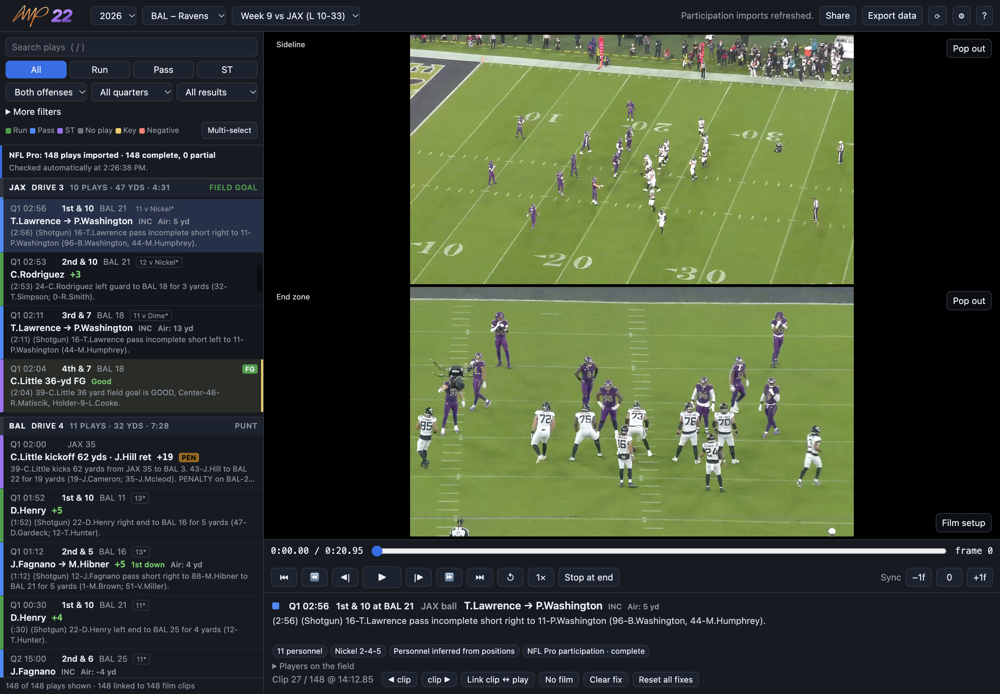

### Choose film in the viewer

Select **Single file** and click **Choose film…** directly in the empty video area. The setup panel also shows film analysis and its progress, then gets out of the way when the analyzed film is ready. This running-app capture uses real 2026 Bengals at Ravens play-by-play before assigning film.

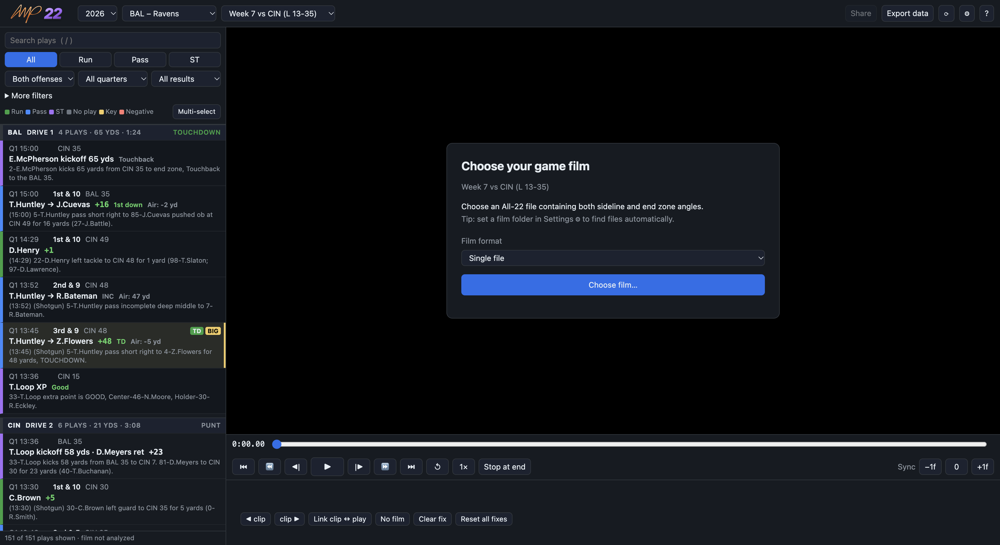

### Split offense, defense, and special teams

Choose **Split offense / defense / ST** in the viewer's setup panel to assign three files. Offense and defense refer to the team selected above; each file contains both camera angles and aligns independently. This is the running app with real Bengals at Ravens play-by-play, before film selection—not a playback or alignment demonstration.

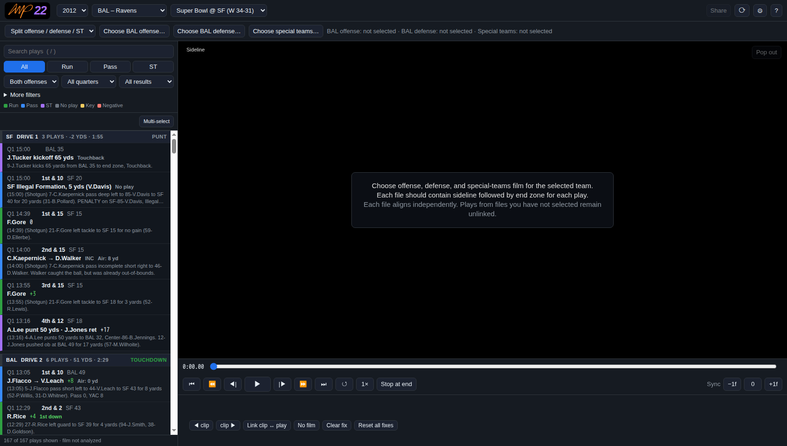

### Filters and charting

Combine offense, play type, result, and air-yards filters with the available quarterback alignment, motion, play-action, box-count, pass-rush charting, and **On-field players** filter. Play-type buttons and every offense, quarter, result, and available advanced dropdown choice show **(N)** matching plays. Counts include search, numeric bounds, selected players, and all other active filters, but replace that control's current selection so you can preview switching choices. **Any/All** counts preview clearing just that filter. Zero-count choices stay selectable, including unavailable preset values. Counts use the full selected scope in Analysis Lab, including week ranges, not just the displayed game's play list.

**Clear all filters** appears beside search whenever any filter is active. It clears search, play type, offense, quarter, result, numeric bounds, advanced choices, and player tags together, and deselects the applied preset without deleting saved presets. The selected game, film links, and export selections remain unchanged.

**Add player** lists only players appearing in plays that match the other active filters: Jacksonville offense, for example, offers actual Jaguars offensive participants and Ravens defenders in that subset, not the whole game roster. Each option shows **(N plays)**: how many plays would match if you added that player alongside everyone already selected. Counts update immediately when players or other filters change, and count each play once. Players with zero matching plays are hidden from the dropdown; removing a selected player restores any newly compatible options without clearing the remaining tags.

The dropdown groups the **selected team first**, followed by the other team, even when the offense filter selects the other team. Group headers and offense choices show the actual team names, not generic team-role labels. Player names are alphabetical within each team by default; **Settings → On-field player dropdown order** also offers matching-play and position ordering.

Select players to add name tags; the play must include **all selected players together** on either side. Each tag's **×** removes just that player; removing the last tag clears the player filter. Selected tags remain visible and removable if other filters exclude their plays, rather than silently clearing a selection. This refreshed sidebar capture from the running app uses actual 2024 Bills at Ravens play-by-play, historical participation, and FTN charting, filtered to **Buffalo Bills offense** and **Motion → Yes**: **24 matching plays**, split evenly between run and pass. It shows live counts and **Clear all filters**, without loading film or fabricating an NFL Pro import.

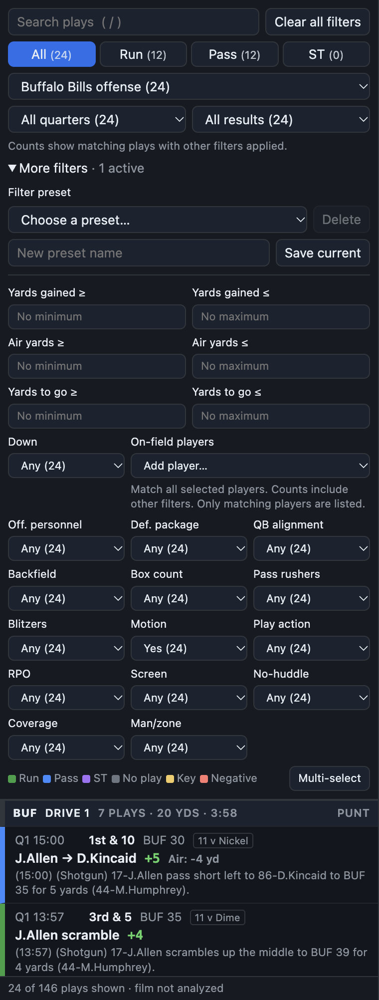

An earlier, genuine NFL Pro capture of 2026 Jaguars at Ravens supplies the additional charting controls below. **NGS pressure → Yes** matches **14 plays**; all 148 plays have complete player lists, and **109 plays have usable NGS charting**. This running-app screenshot uses the subscriber's schema v2 CSV, not generated charting. The capture also tags one quarterback kneel, which AMP22 excludes under its existing run/pass charting rules. Film is not loaded.

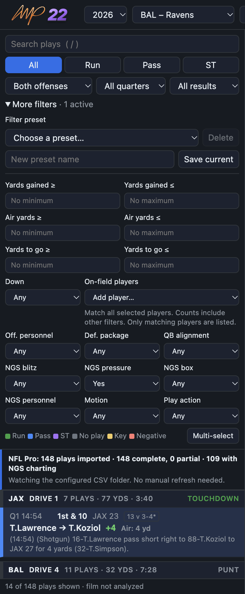

Sources can genuinely disagree. A second subscriber capture, 2026 Week 4 Titans at Ravens, matches all **159 plays** with complete player lists and overlaps existing FTN charting. It has **29 plays with disagreements**: 23 motion, five play-action, and four alignment differences, with some on the same play. AMP22 retains every existing FTN value, adds the separate NGS fields, and exposes the alternatives in play details and both data-export layouts. This actual running-app capture shows Q1 4:38: **FTN Shotgun retained; NFL Pro Pistol**. The comparison does not establish which provider is correct; no disagreement has been automatically reconciled or fabricated, and film is not loaded.

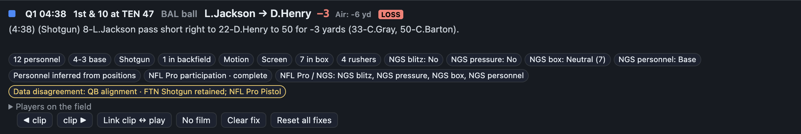

### Reusable filter presets

At the top of **More filters**, name the current filter set and click **Save current**, then choose it from **Filter preset** in another game. Presets save search, play type, offense, quarter, result, numeric bounds, and advanced selections locally across app restarts. Offense is stored relative to the selected team or its matchup opponent, so it follows that role in another game. The UI displays the resolved team name, not the internal role. Applying a preset replaces the current filters; editing them does not change the saved snapshot. Use a new name to save a variation, or **Delete** to remove the selected preset without changing current filters.

Specific players bind a preset to the analyzed team, even when some selected players belong to the opponent. For a different analyzed team, AMP22 offers **Apply without players** or **Cancel** before changing filters. Missing player/personnel data prompts guidance to capture and import the game's NFL Pro CSV (subscription required); historical participation can also satisfy those filters. Updated captures can supplement alignment, motion, and play action, and add separate NGS filters; unavailable FTN-only fields and coverage remain missing. Unavailable preset choices remain visible and applied rather than silently broadening results, and can match after imports refresh. Plays without the required data do not match.

This refreshed running-app capture uses the real 2024 Bills at Ravens game and **Third-down passes**, an analyzed-team preset with six matching Baltimore plays. Live counts preview the other choices, and **Clear all filters** resets the current set without deleting the preset. Film is not loaded. Choose a preset again after loading another game; preset-derived current filters reset on game load so its team and data checks run afresh.

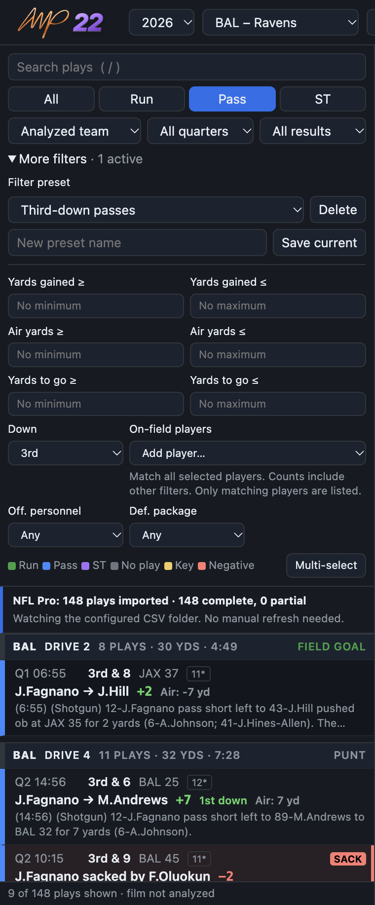

### Ordered players on the field

Expand **Players on the field** below the viewer. Offense is ordered **WR, RB, FB, TE, eligible extra OL, QB, LT, LG, C, RG, RT**; defense is ordered **DE, DT, OLB, ILB, CB, safeties**. NT groups with DT and MLB with ILB, without changing their listed labels. Players within a group are ordered by jersey number. Generic or unusual listed positions remain visible rather than being guessed.

For generic offensive T/G/OL positions, AMP22 uses published nflverse depth charts to infer compatible left/right roles by **team and GSIS ID**. An asterisk, such as **LT***, marks a depth-chart estimate—not confirmed alignment on that snap. Hover over the position for its source, snapshot date, and original listed position. Modern charts use the latest snapshot on or before the game's date; older charts use the exact season, week, and game type. Equally ranked left/right assignments remain generic. Explicit source LT/LG/C/RG/RT positions are never replaced. Charts are downloaded automatically when needed, cached for offline use, and failures produce a data warning while retaining listed positions.

An eligible extra lineman appears as **OL-E** between TE and QB only when the play description explicitly reports that offensive lineman eligible, uniquely matched by jersey number, and the on-field list contains at least six linemen. A depth chart or an extra lineman alone does not establish eligibility. This running-app capture uses the actual Jaguars–Ravens Q1 10:31 play: Carson Vinson is explicitly reported eligible, while the other linemen's asterisks distinguish chart-derived sides.

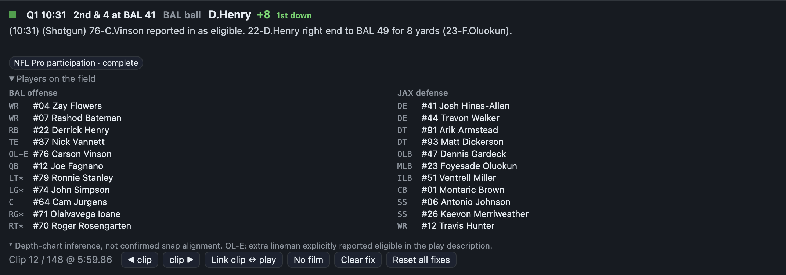

### CSV analysis without film

**Export data** saves filtered, selected, or all game plays, with all available statistics and participation. Choose one row per play or one row per player per play. This is the actual export dialog in the running app with real 2024 Bills at Ravens data; an independent player-row CSV was exported successfully without loading film. It does not demonstrate live NFL Pro collection.

**Defensive package** uses the same classifier and saved package rules as Analysis Lab, including **Big nickel***, **Standard nickel***, **Standard dime***, and **Rush dime*** when complete, unique eleven-player position evidence supports them. **Inferred defensive package** also records composition-based labels. The asterisk marks a listed-position estimate, not verified alignment; partial or ambiguous lists retain supplied broad packages or blank unknown values. Base and named heavy packages use short names: **3-4**, **4-3**, **Jumbo**, **Jumbo nickel**, and **32 dime**, without redundant front counts. Broad packages retain useful composition details, such as **Nickel 2-4-5** or **Dime 1-4-6**. The same formatting applies to Share's CSV/text/PDF breakdowns.

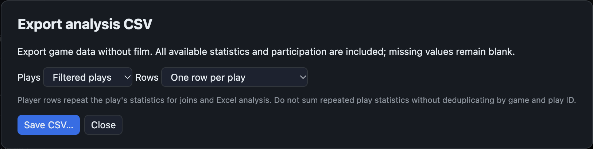

### Analysis Lab

Choose **Analysis side** at the top of the left sidebar: the selected team's **offense** or **defense**, labeled with its actual name (for example, **Baltimore Ravens offense**). It sits alongside the Film Room filters instead of in the results toolbar. Switching sides automatically narrows the sidebar play list to that side's scored snaps in the current analysis scope; no separate possession filter is needed. Other filters still apply, and hidden play selections stay selected. The possession filter below it can further narrow the chosen side, including individual opponents across a week range.

Use **Multi-select** in the sidebar or expand **Select plays for analysis** to check individual plays, Shift-click a range, or **Select all filtered plays**. Choose **Analyze → Only selected plays** to study a hand-picked set, or **Exclude selected plays** to remove outliers without inventing a filter. Charts, statistics, evidence, and exports immediately use that choice together with the existing sidebar filters and perspective. The picker still lists excluded plays so you can uncheck and restore them; **Show → Selected plays** also exposes selections hidden by other filters.

Selections span the full analysis scope using game/play IDs, so matching play numbers from different weeks stay distinct. An empty selection means zero snaps in **Only selected plays**, and excludes nothing in **Exclude selected plays**. **Clear play selection** removes the checks; **Clear all filters** restores **All filtered plays** without erasing them. Selections survive data reloads and are cleared when the selected game, team, season, or week scope changes. Summary CSVs and graphics record the selection mode and count; CSVs also list selected game/play IDs. Film Room's cutup selection behavior is unchanged.

This running-app capture selects Buffalo's first three scored snaps in the actual 2024 Bills at Ravens game: two passes and a scramble. **Only selected plays** reports three Baltimore defensive snaps with known personnel and EPA, using real nflverse play-by-play and historical participation. No film was loaded.

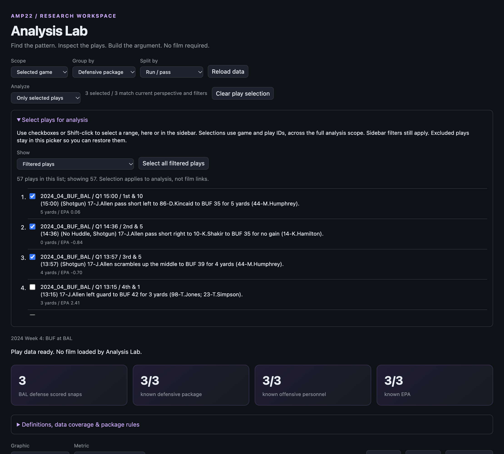

Introduced in **0.6.0**, Analysis Lab compares defensive packages with run/pass efficiency, EPA, success, explosives, and conversion rates. Packages are ordered by their combined snap counts, with run and pass rows adjacent (run first). Base packages use the short names **3-4** and **4-3**, without redundant personnel counts; other broad package labels retain their composition details. Switch to a personnel matchup heatmap or half comparison, then click a graphic or table row to inspect the actual plays. This running-app capture uses real 2024 Bills at Ravens play-by-play, historical participation, and FTN charting: **57 Baltimore defensive scored snaps**, with all 57 having known personnel and EPA. **Big nickel*** is a listed-position composition estimate, not verified defensive alignment. No game film was loaded.

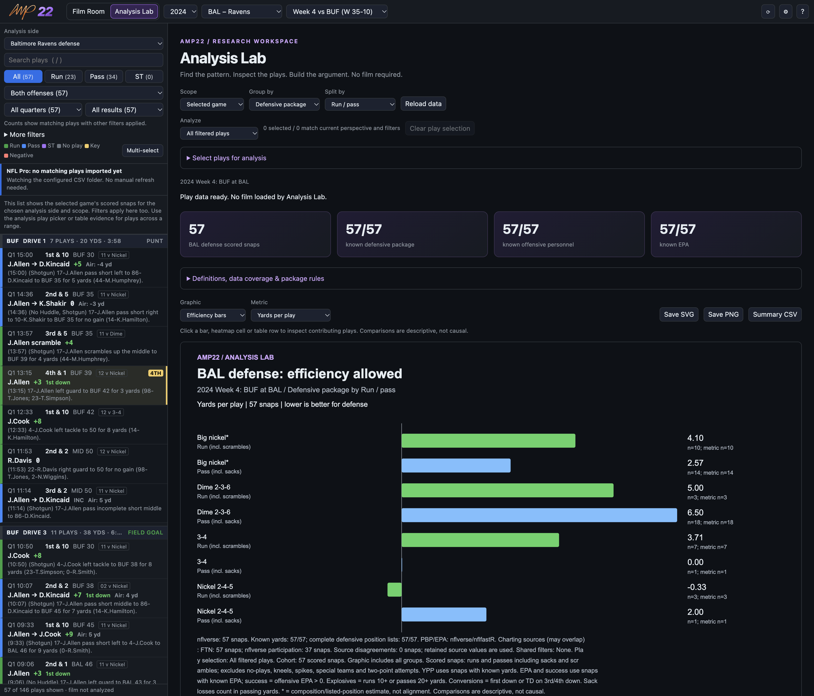

**Jumbo*** identifies a complete eleven-player defense with at least four listed defensive linemen (DE/DT/NT), at least two OLBs, and no more than four defensive backs. This is a heavy-front composition estimate, not verified alignment or a field-position filter. Generic LB positions are not assumed to be OLBs; ordinary 3-4, 4-3, and nickel packages retain their classifications. Exact custom package rules take precedence in Analysis Lab. Jumbo is also available in the defensive-package sidebar filter and play-data exports.

This running-app capture uses the actual 2026 Week 9 Jaguars at Ravens game and imported NFL Pro participation, with the **Jumbo** defensive-package filter selected. The **Jumbo*** bucket contains two Baltimore defensive snaps at its 1-yard line: Q1 12:08 (incomplete pass) and Q1 11:24 (1-yard touchdown run). No film was loaded.

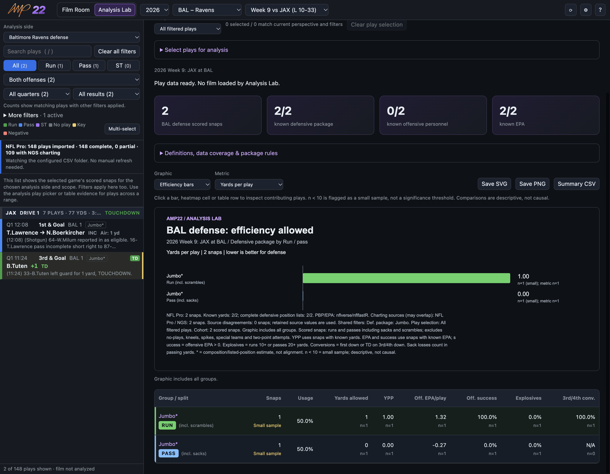

**32 dime*** identifies three listed DL/OLB combined, **two explicit inside linebackers** (ILB/MLB), and six defensive backs. Generic LB positions do not establish an inside role, and `1-4-6` alone is not enough to assign this label. Complete, unique on-field lists are required for composition estimates; custom exact-composition rules still take precedence in Analysis Lab. Sidebar filters and play-data exports use the same classification.

This actual 2026 Jaguars at Ravens capture shows the **32 dime** filter and its one snap, Q1 2:11: an incomplete pass to Parker Washington. Calais Campbell plus OLBs Trey Hendrickson and Mike Green form the three; Roquan Smith and Trenton Simpson are the two inside linebackers. No film was loaded, so the asterisk marks listed-position inference rather than verified alignment.

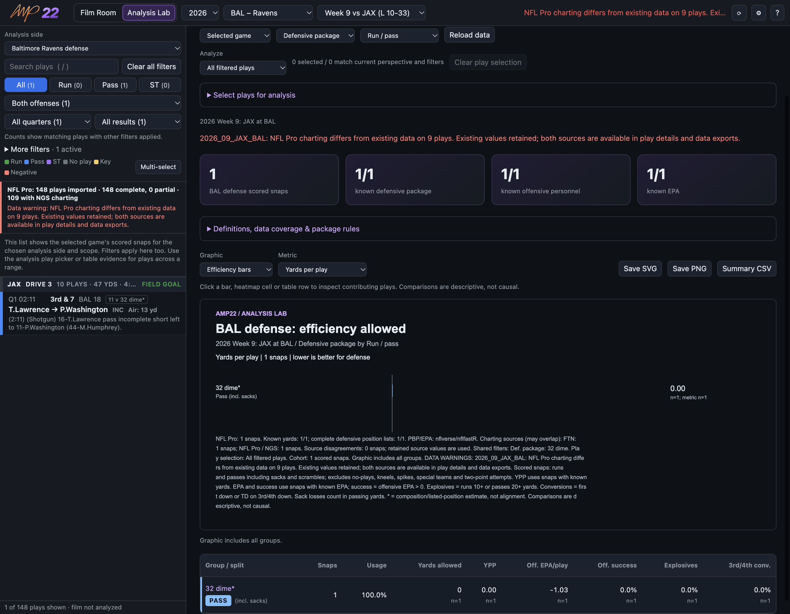

**Jumbo nickel*** identifies **three DL, one OLB, two explicit ILB/MLB, and five DBs**: a nickel composition with one OLB replaced by a defensive lineman. Both standard nickel's three CB/two safeties and big nickel's two CB/three safeties qualify. Complete, unique eleven-player position lists are required for on-field estimates; generic LB positions do not establish inside/outside roles. This classification is shared by Analysis Lab, defensive-package filters, and exports, with exact custom rules taking precedence in Analysis Lab and exports. No matching real snap was available for a representative Jumbo nickel screenshot; the existing game captures do not demonstrate this package.

The same game with **Analysis side → Baltimore Ravens offense** and **Group by → Offensive personnel** shows **54 scored offensive snaps**: 34 runs and 20 passes, with known personnel and EPA. The sidebar automatically shows only those Ravens offensive snaps, rather than both teams' plays. This is an actual running-app capture; no film was loaded.

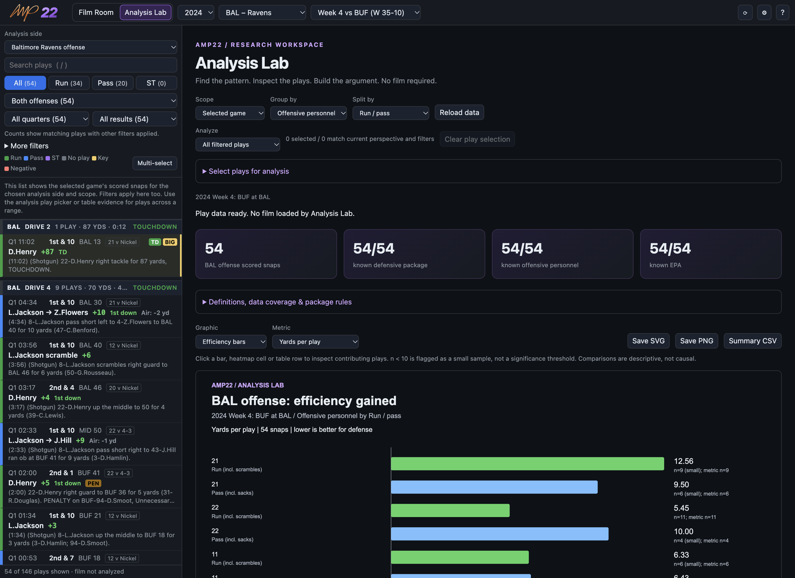

Run/pass results use bold green **RUN** and blue **PASS** badges, matching the charts, with subtle row tints and colored edges. Scramble and sack inclusion remains explicit. Snap counts and per-metric sample sizes remain visible without automatic "small sample" warnings. This refreshed detail of the same Bills–Ravens results table shows the adjacent comparisons.

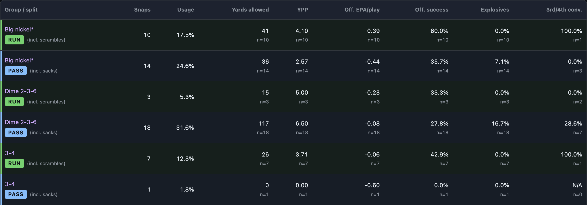

The matchup heatmap compares defensive packages against offensive personnel for the same 57-snap cohort. Each populated cell shows yards per play and its sample size; click it to inspect the contributing plays. Empty cells are unavailable, not zero.

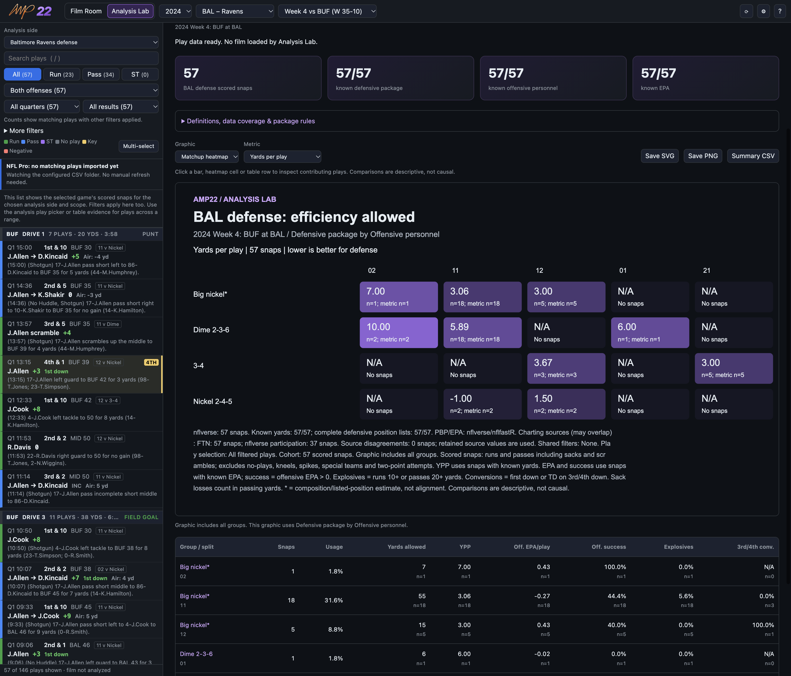

### On-device Analysis Lab questions

This running-app capture uses the real Apple on-device model and actual 2024 Bills at Ravens play-by-play and historical participation. The question compares yards per play across **57 Baltimore defensive snaps**: **34 passes at 4.56 YPP** and **23 runs at 3.52 YPP**, calculated by AMP22 rather than generated by the model. The interpreted query, metric denominators and data-coverage counts remain visible, alongside the manual **Copy analysis…** action. No film was loaded.

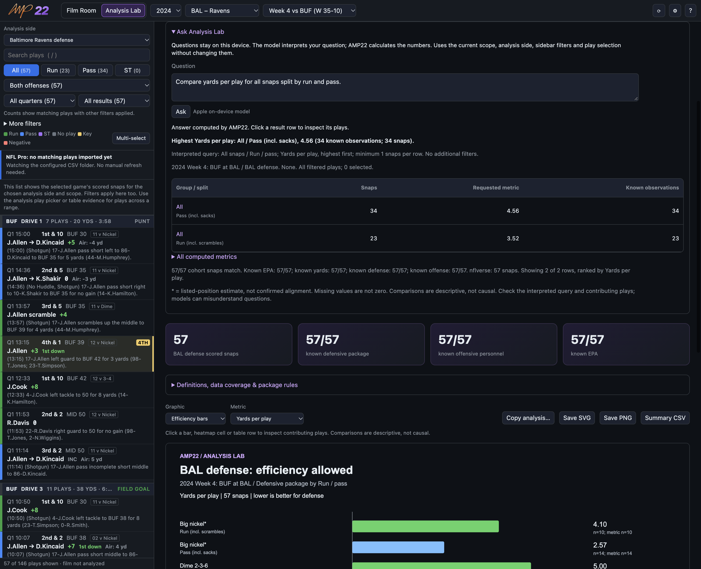

Player-presence questions compare the same cohort with and without one named player. This actual Apple-model capture uses **2024 Bengals at Ravens** participation data, not inferred absences or simulated results: **39 defensive snaps with Kyle Hamilton and 36 confirmed without**, with no unknown-participation snaps. The interpreted query identifies the player, each group's snaps remain inspectable, and the expanded **All computed metrics** table includes separate denominators.

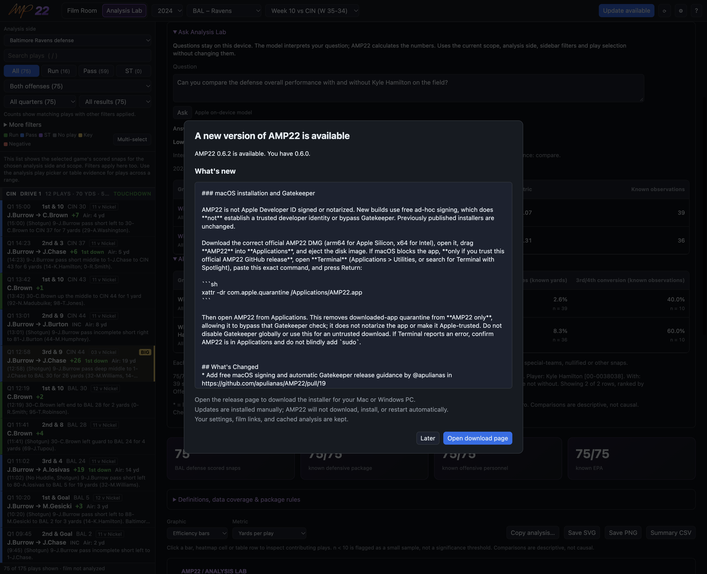

### Optional cloud accounts and external-chat export

The actual running-app cloud configuration dialog is shown **without a connected account or API key**. It explains separate API billing, encrypted credentials, per-request confirmation and immediate provider saves. This is a setup capture, not a demonstration of successful cloud inference.

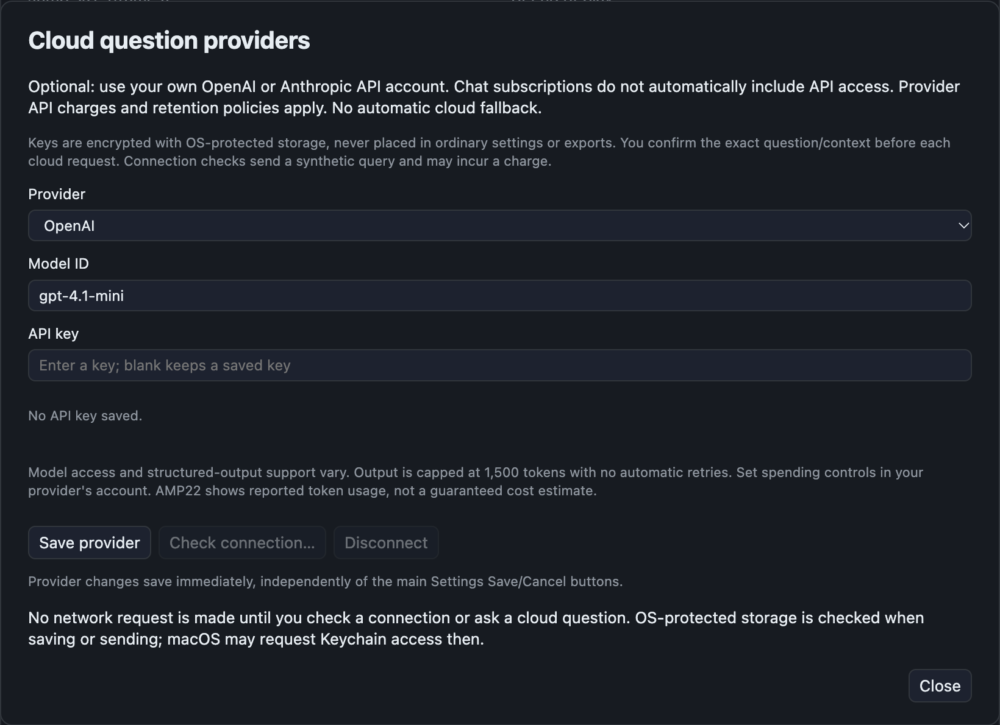

The external-chat preview below contains the same game's **actual computed defensive-package/run-pass table**, including metric samples. It is scrolled to the aggregate CSV rows; the full text also contains scope, definitions and source caveats. Nothing has been copied or transmitted in this capture. This manual workflow works with an existing chat subscription without integrating its login into AMP22.

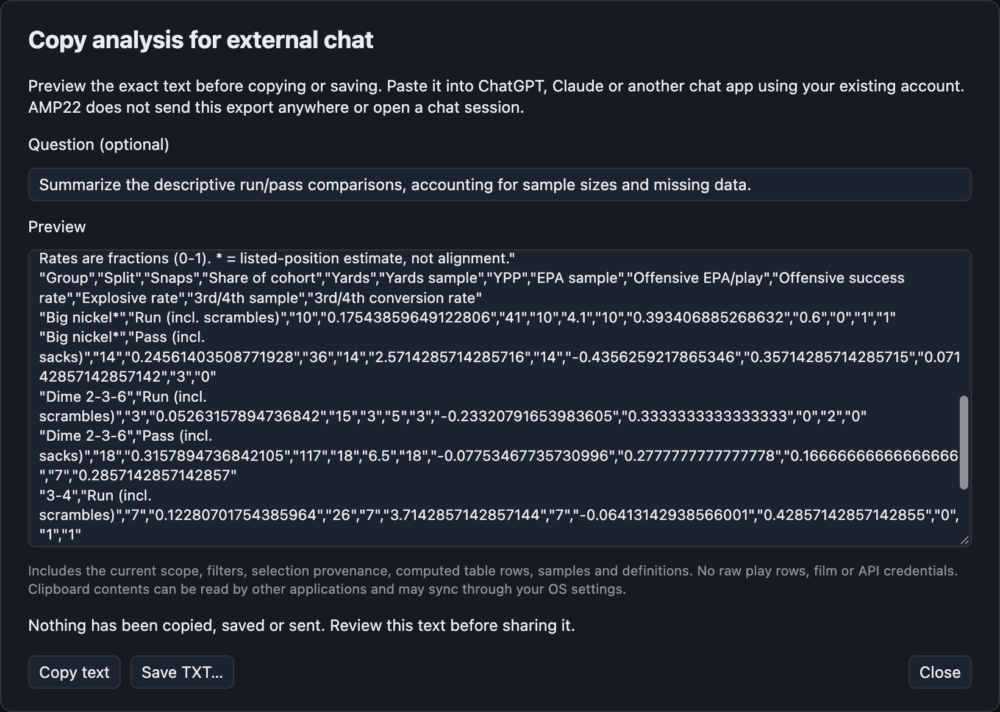

### Multi-play clip export

Export selected plays as sideline, end zone, stacked portrait, or all sideline followed by all end zone (and the reverse) in one video. Trim clip starts with per-play first-frame previews, set an overlay duration, or choose a clean export. Choose a team theme, customize its colors and background opacity, and save named themes or a new default. Position the overlay with corner presets, drag it on the export preview, and save named locations. Share also offers a CSV, plain-text, or team-colored PDF play breakdown, with optional advanced statistics. This running-app capture shows the theme and position controls with a top-right Ravens card. It uses a simulated field and illustrative play because game film was unavailable; it does not demonstrate real game alignment or a completed export.

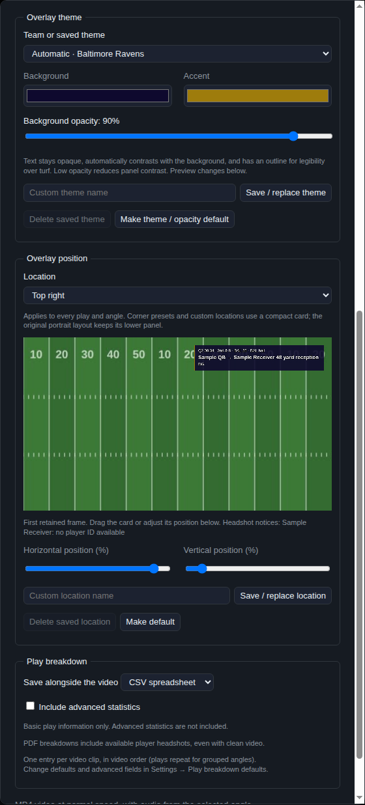

### Overlay theme examples

These examples use AMP22's actual overlay renderer with a simulated field and illustrative play, not game film. Ravens, Chiefs, Eagles, and Bengals presets use dark team-colored panels with contrasting text. The custom light theme and 40%-opacity Ravens example demonstrate editable colors and transparency; text remains opaque and outlined.

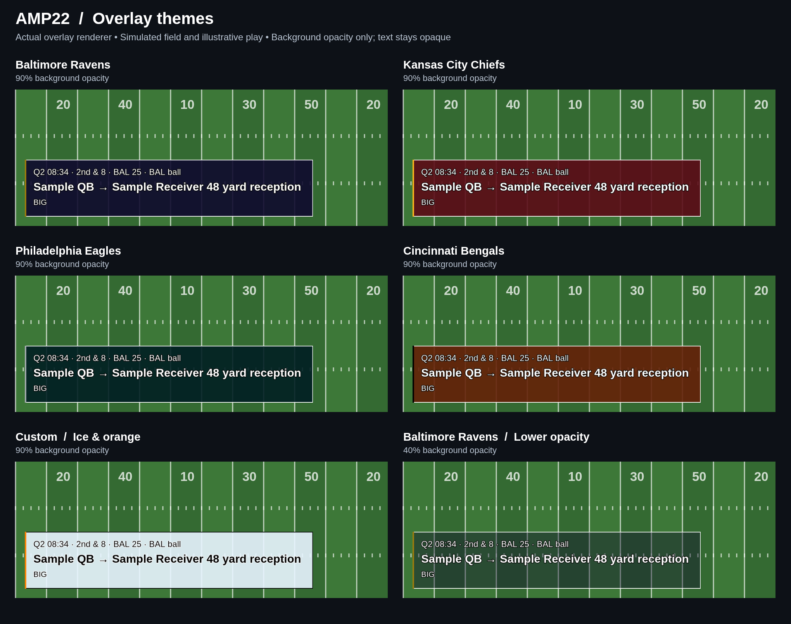

### PDF play breakdown

PDF writeups include available player headshots alongside each play, including when the accompanying video uses **Clean export** or zero overlay duration. This is the first page of an actual two-play PDF exported from the running app with the supplied Bengals at Ravens film, showing Derrick Henry's headshot and real play-by-play and charting.

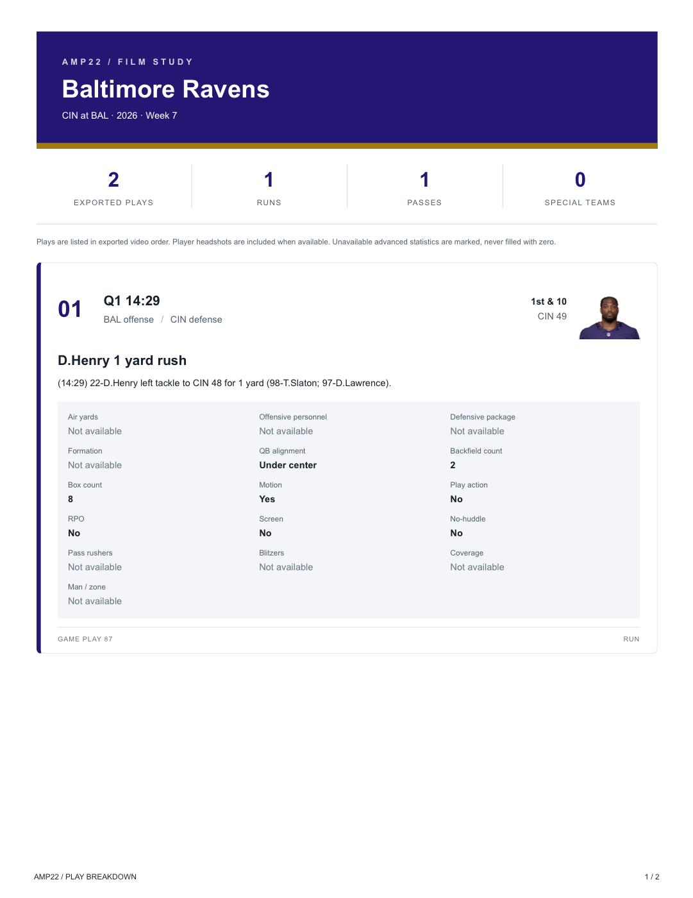

### Settings and shortcuts

**On-field player dropdown order** offers **Alphabetical** (default), **Most matching plays first**, or **Position, then most matching plays** within each team group. Play counts sort highest first and update with active filters and selected players; ties are alphabetical. Position sorting follows the offensive and defensive position sequences described above, with specialists and unknown positions last. Compatible depth-chart estimates appear with an asterisk; a player's reported-eligible snap does not turn eligibility into their overall dropdown position. Saving applies the order immediately and preserves it across restarts without changing selections or reanalyzing film. This crop from the running app shows the default alphabetical preference.

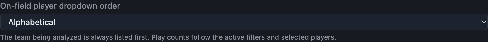

Customize playback, clip-start trimming, overlay duration, and play-breakdown defaults, including the report format, whether advanced statistics are enabled, and exactly which fields to include. This running-app crop focuses on report defaults, including player IDs, names, positions, jersey numbers, and participation provenance. The participation import folder is configured above this section; key-play definitions and keyboard shortcuts remain below it.

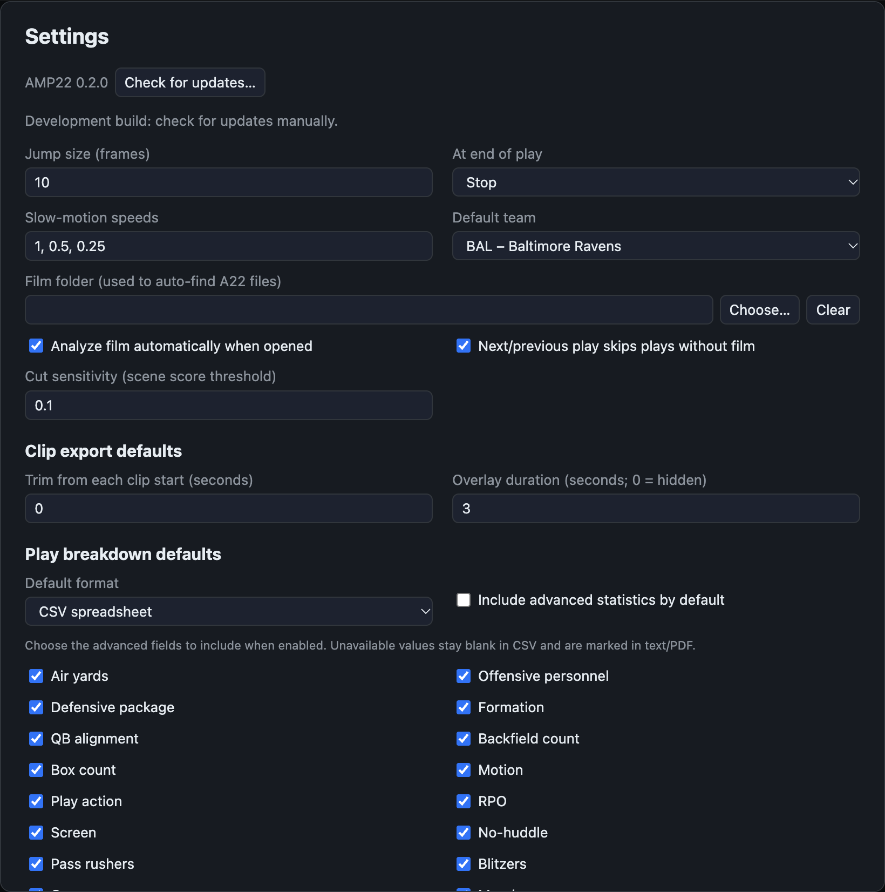

### Update notifications

See the latest published release notes before opening the download page. This is the running app checking a real GitHub release; installation remains manual.

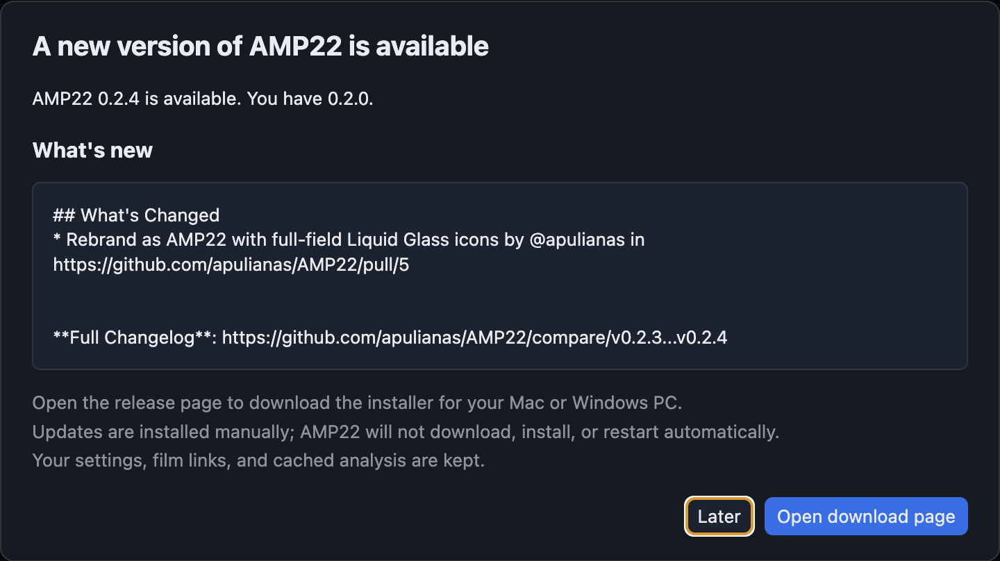

## Features

- **Analysis Lab.** A film-independent workspace for one game or a completed-game week range for the selected team and season. Choose offense or defense; group by defensive package, offensive personnel, personnel matchup, half, pass-rusher count, exact defensive lineup, or all snaps. Split by run/pass, half, offensive personnel, motion, or play action. Tables show snaps, cohort usage, yards, YPP, offensive EPA/play, offensive success rate, explosive rate, and third/fourth-down conversion rate with each metric's sample size. Efficiency bars, a defensive-package/offensive-personnel heatmap, and half comparisons export as PNG/SVG; Summary CSV includes every group and definitions. Click bars, cells, or table rows for play evidence and a full-field play CSV. Custom eleven-player package rules distinguish big nickel, standard nickel, standard dime, and rush dime when listed positions support them; ambiguous or partial lists retain broad supplied packages or Unknown. Rules and the workspace preference are saved locally.
- **Optional analytics questions.** Ask for computed efficiency comparisons using Apple's system model on supported Macs, an independently installed local Ollama model on Windows, or an explicitly configured OpenAI/Anthropic API provider on either platform. AMP22 interprets questions into bounded queries, calculates the results itself, and exposes the query, sample sizes and contributing plays. Cloud requests require confirmation of the exact payload, use OS-protected encrypted API keys and display reported token usage. No automatic cloud fallback or bundled model; the question panel is hidden without an available/configured provider.
- **Copy analysis for external chat.** Preview the current computed table, scope, filters, selection provenance, sources and definitions, then copy text or save a TXT for an existing ChatGPT/Claude subscription. This manual export requires no model or API key, never sends data itself, and does not include raw play rows or film.
- **Two synced angles.** Each A22 file contains sideline followed by end zone for each play. The app finds the cuts, pairs the angles, and plays them together on one clock. Use **Single file** for continuous full-game film, or **Split offense / defense / ST** for separate offense, defense, and special-teams files. In split mode, offense means the selected team's offense and defense means that team defending; the special-teams file covers kicks and returns by either team. Each file aligns independently, and selecting a play switches both viewers to the appropriate source. You can load only the files you have; the other plays remain unlinked. File choices and corrections are remembered per game and team perspective, separately from single-file film. The layout switches between side-by-side and stacked depending on the window shape.
- **Multi-monitor viewing.** After film analysis, click **Pop out** on either angle to open it in a separate window. Drag that window to another display and maximize it or click **Fullscreen**. The remaining angle fills the main viewer. Playback, seeking, frame stepping, speed changes, sync offsets, and play navigation still use the same controls and clock; keyboard shortcuts also work in the pop-out. Click **Return angle** in either window, or close the pop-out, to restore the two-angle layout. One angle can be detached at a time.
- **Play-by-play navigation.** Pick the season, team, and week from the drop-downs. The default is the current season, the Ravens, and the most recently completed week. Plays come from [nflverse](https://github.com/nflverse/nflverse-data) and are color-coded:
  - **Run** is green, **pass** is blue, **special teams** is purple, and **no play** (penalty) is gray.
  - **Key plays** get a gold edge and badges: INT, FUM, TOD (turnover on downs), TD, FG, SAF, 2PT, BIG (run ≥ 10 or pass ≥ 20 yards), 4TH (4th-down conversion), and optionally SACK.
  - **Negative plays** get a red edge and a SACK or LOSS badge. These are sacks, plus runs and completions that lose 3 or more yards.
  - You can change the key-play and negative-play definitions in Settings.
  - Plays are grouped by drive. Each drive has a header showing the team, number of plays, yards, time of possession, and result.
  - Each play shows a box-score line first, for example `T.Huntley → Z.Flowers +48 TD`, with the full play description below it in smaller text.
  - The list can be searched and filtered by play type (run, pass, special teams), offense, quarter, and result. Result filters: key, negative, sacks, turnovers, scores, big plays, first downs, penalties. The quarter list includes OT only when the game went to overtime.
  - Expand **More filters** below the offense/quarter/result controls to enter an inclusive minimum (`Air yards ≥`) and/or maximum (`Air yards ≤`). Leave either field blank for no limit; zero and negative bounds are supported. These filters combine with the other controls, and plays stay in game order with drive headers. Collapsing the section keeps its filters applied and shows an active indicator; clear both fields to remove the air-yards filter. Plays without air yards (such as sacks and runs) are excluded only while a bound is set, not treated as zero.
  - Air yards measure pass depth from the line of scrimmage, excluding yards after catch; throws behind the line have negative values. Available values appear beside the play result, including on incomplete and intercepted passes. Historical coverage varies. Previously downloaded play-by-play is reprocessed automatically to include air yards.
  - **More filters** also has inclusive **Yards gained** bounds (runs and passes only; kickoffs, punts, and no-plays are excluded while a bound is set) and **Yards to go** bounds, plus a **Down** selector. The indicator shows how many of these filters are active.
  - **Saved filter presets.** **More filters → Filter preset** applies a named snapshot of all current filters, including the search and controls above the advanced section. Enter a new preset name and click **Save current** to keep one across games and app restarts. Offense selections display team names while their saved roles adapt to each matchup. Presets containing player selections are marked with the selected team's abbreviation; another team requires **Apply without players** or **Cancel**. Missing participation produces NFL Pro import guidance, while unavailable preset choices remain applied and removable. Choose a preset again after loading a game. **Delete** removes the saved preset, not current filters.
  - **Personnel and charting.** When nflverse or an imported NFL Pro capture has advanced data for the game, more filters appear under **More filters**. Filters with data for the loaded game are shown, along with any unavailable choices retained from an applied preset, and all apply to runs and passes only:
    - From [FTN charting](https://github.com/nflverse/nflverse-data/releases/tag/ftn_charting) (2022 onward, updated during the season): QB alignment (shotgun, under center, pistol), backfield count, box count, motion, play action, RPO, screen, no-huddle, and, on dropbacks, pass rushers and blitzers.
    - From [participation data](https://github.com/nflverse/nflverse-data/releases/tag/pbp_participation) (2016 onward, published after each season ends, so not available for the current season): offensive personnel (RB count then TE count, e.g. `11`, `12`, `21`), defensive package, formation (before 2023), coverage (Cover 0/1/2/3/4/6/9, 2-Man…), and man/zone.
    - From an updated **NFL Pro CSV capture**: QB alignment (including pistol), motion, and play action fill missing existing values. Separate **NGS blitz**, **NGS pressure**, **NGS box**, and **NGS personnel** filters retain NFL Pro's boolean flags and categorical groupings rather than inventing exact counts or defensive fronts. Missing filter membership remains unknown, not **No**. These fields are applied only to scrimmage plays.
    - **Source priority and disagreements.** FTN stays authoritative where present, followed by existing historical participation data; NFL Pro fills remaining gaps. Every effective charting field has source metadata. Comparable values that differ produce a persistent data warning and a highlighted play-detail tag showing the retained value and the NFL Pro alternative. Both sources and capture provenance are retained in **Export data** and selectable advanced report fields. Disagreement can reflect different charting definitions, not necessarily an incorrect source. NGS box categories and blitz flags intentionally remain separate from FTN box/rusher/blitzer counts; NGS Base/Nickel/Dime remains separate from a charted or position-inferred defensive package.
    - Defensive packages are derived from the number of defensive backs: four DBs are labelled by their front (`4-3`, `3-4`), five are **Nickel**, six **Dime**, seven or more **Quarter**, and three or fewer **Goal line**. Each label also shows the DL-LB-DB count (for example `Nickel 2-4-5`).
    - Play rows show personnel as `12 v Nickel`. The play details below the video list every personnel and charting tag, and **Players on the field** lists both sides' players in position order (jersey numbers from 2023 onward). Compatible depth-chart left/right offensive-line estimates are marked with an asterisk, with source/date tooltips; ambiguous positions remain generic. Explicitly reported eligible extra linemen appear between TE and QB. Search also matches these tags, for example `nickel` or `play action`.
    - Each season's files (about 10–50 MB) are downloaded once and cached for offline use.
  - **Local NFL Pro participation imports (experimental).** The optional WebExtension's **Capture game & save CSV** button fetches the game's unfiltered NFL Pro playlist and participation for every returned play, then automatically requests the CSV download. No manual play navigation or separate export click is required. AMP22 checks `nflpro-*.csv` in your Downloads folder by default, imports matching plays when loading a game, and watches for new files while running. A persistent sidebar indicator shows imported-play counts across the entire open game, complete/partial counts, and the last automatic update or check; filtering does not change these counts. Updates preserve the current play, selections, and loaded film. No manual refresh is required. Choose another folder or disable imports in **Settings → Participation CSV folder**. It verifies game metadata and play situations, never joins by list order, and reports invalid files, ambiguous matches, and unavailable folder watching in the indicator. Historical participation and FTN charting remain available; partial imports do not displace complete historical sides, and more complete captures are preferred over partial ones. Imported participation is labelled complete or partial per play; this is not a whole-game coverage claim.
  - **Player filtering and inferred personnel.** **More filters → On-field players** supports multiple players as removable name tags. Only plays with all selected player IDs on the field together match, across either side—not just the passer, receiver, or players mentioned in the description. Choose **Add player…** to add another, or use a tag's **×** to remove that player. Options follow all other active filters, using actual snap participation rather than a roster's listed offensive/defensive positions. Each option's **(N plays)** count predicts the combined result of adding that player; counts and available options update when selected players or other filters change. Candidates with zero matching plays are hidden and reappear when compatible again. An empty subset disables the picker with an explicit message; existing tags stay removable and are not silently cleared. Removing all tags restores unrestricted player matching. Player selections survive participation refreshes while those players remain available in the game, and filtered CSV exports use the same combined filter. Search also matches on-field names, positions, and jersey numbers. Complete eleven-player sides with known positions can supply missing offensive personnel or defensive package labels. An asterisk and detail tag identify inferred values; listed positions do not establish actual alignment. Supplied offensive personnel is retained. Complete defensive composition can refine a broad label to Jumbo, Jumbo nickel, or 32 dime; Analysis Lab and exports also apply detailed nickel/dime and custom package rules. Inferred values are exported separately, and source CSVs are never modified.
- **Independent analysis CSV.** **Export data** works without film and exports filtered, selected, or all plays in game order. Every available advanced field is included, regardless of Share's report preferences. **One row per play** includes parallel semicolon-separated player lists; **One row per player per play** includes individual player identity, team, side, original position, and jersey number alongside repeated play statistics. Depth-chart position estimates, their sources and snapshot dates, and explicitly reported eligibility are separate fields; original positions are never overwritten. An empty **Reported eligible** field means not identified, not confirmed ineligible. Both layouts include nflverse game/play IDs and available participation provenance and inference fields. Plays without participation retain a blank-player row. Missing statistics stay blank, while zero and **No** remain distinct.
- **Frame-accurate controls.** Step 1 frame or N frames at a time (N defaults to 10 and is configurable). You can also move to the next or previous play, restart the play, and change to slow-motion speeds. At the end of a play the app can stop, auto-advance, or loop.
- **Clip export.** Click a play and then **Share** to export its sideline angle, end zone angle, or both. Shift-click another play to select the visible plays in between, or turn on **Multi-select** to choose individual plays. Checkboxes are hidden during normal single-play browsing. Selected plays are joined into one MP4 in game order, even when selected out of order. Both angles are stacked in a 1080×1920 (9:16) portrait video; the original layout places the play's clock, down/distance, box-score result, badges, and description below, without camera-angle labels over the footage. Single-angle exports are 1920×1080 with a compact result card. Choose a corner preset or drag the card on the export preview, save named locations, and make any location your default. Custom and corner positions use a compact card over centered footage in portrait output. **All sideline, then all end zone** and **All end zone, then all sideline** produce one 1920×1080 MP4, with all selected plays in game order within each angle block. Trim starts independently per play using decimal seconds and preview the first retained frame of the selected angle or angles. Overlay duration is configurable for every layout, measured from each trimmed clip start. Settings remembers the user's trim and overlay defaults locally. Exports use normal speed and saved sync offsets, with audio from the selected angle (sideline for stacked portrait). Playback and original film are never modified.
- **Ordered play breakdowns.** Share can save a **CSV spreadsheet**, **plain text**, or **PDF** alongside the video, with one entry per video clip in exactly the same order—including exports spanning split files. Grouped-angle exports repeat the selected plays for the second angle block. Reports identify the matchup and include each play's clip number, game play ID, quarter/clock, offense/defense, play type, down/distance, field position, yards, result, and description. PDFs use the selected team's colors, team-colored play cards, a run/pass/special-teams summary, and page numbers. **Include advanced statistics** adds the fields selected in Settings: air yards, personnel/packages, formation, QB alignment, backfield/box counts, motion, play action, RPO, screen, no-huddle, pass rushers/blitzers, coverage, and man/zone. Missing data stays blank in CSV and is marked **Not available** in text/PDF; zero and **No** remain distinct from missing values. The default is **CSV without advanced statistics**. Settings lets you customize the format, advanced-statistics default, and individual fields; Share lets you override the format and toggle advanced statistics for the current export or choose **No breakdown**.
- **Update notifications.** Installed macOS and Windows builds check GitHub for a newer stable release at startup. The prompt shows your version, the latest version, and its published changelog. **Open download page** opens that release in your browser; choose the macOS DMG or Windows installer and install it manually. **Later** suppresses startup prompts for that version, but the **Update available** button stays accessible and newer versions can notify again. If playback, export, or another dialog is active, the button appears without interrupting your work. **Settings → Check for updates…** always lets you check again, including in development builds. Network failures are shown in Settings and can be retried.

## Getting started

For packaged releases, choose the **arm64 DMG** for Apple Silicon Macs (M-series), the **x64 DMG** for Intel Macs, or the **Windows installer**. Each installer includes the video-processing tools it needs. Apple Silicon builds include native arm64 versions of the app, FFmpeg, and FFprobe and do not require Rosetta 2. Intel builds run both helpers natively.

### macOS installation and Gatekeeper

AMP22 is **not Apple Developer ID signed or notarized**. New builds use free **ad-hoc signing** to give the complete app a valid local signature, including its Electron helpers and video tools. This does **not** identify a trusted developer or make Gatekeeper trust the download. A free Apple developer account cannot provide Developer ID distribution signing; that requires paid Apple Developer Program enrollment. Ad-hoc signing applies to installers built with this configuration; adding instructions to older release descriptions does not change their binaries.

1. Download the correct DMG from the [official AMP22 GitHub release](https://github.com/apulianas/AMP22/releases/latest), open it, and drag **AMP22** into **Applications**.
2. Eject the disk image, then open AMP22 from Applications.
3. If macOS blocks the app, **only if you trust this official AMP22 release**, open **Terminal** (Applications → Utilities, or search for Terminal with Spotlight). Paste this exact command and press Return:

```sh
xattr -dr com.apple.quarantine /Applications/AMP22.app
```

Open AMP22 from Applications again. The command removes downloaded-app quarantine recursively from **AMP22 only**, allowing it to bypass that Gatekeeper check. It does **not** notarize the app, repair an invalid signature, or make the app Apple-trusted. Do not disable Gatekeeper globally or run this for an untrusted download. If Terminal reports an error, confirm the app is named **AMP22.app** and is installed in **Applications**; do not blindly add `sudo`.

### Running from source

Requirements: Node.js 20 or later.

```sh
npm install
npm start
```

npm 11 blocks install scripts unless they are approved. The `allowScripts` entries in `package.json` approve the download scripts for `ffmpeg-static` and `@derhuerst/ffprobe-static`. If the Electron binary is missing, run `node node_modules/electron/install.js`.

### Using it

For statistics and graphics without video, select **Analysis Lab** and follow [Using Analysis Lab](#using-analysis-lab). The following workflow describes **Film Room**.

1. Choose the season, team, and week. The schedule and play-by-play are downloaded and cached, so games you've opened before also work offline.
2. In the empty video area, leave **Single file** selected and click **Choose film…** for full-game A22. For separate units, select **Split offense / defense / ST**, then use **Choose [team] offense…**, **Choose [team] defense…**, and **Choose special teams…** in the same panel. Each file must contain both angles, not one camera per file. Select the team whose offense/defense the files describe before assigning them. The app streams files from where they are and never copies or changes them. After loading analyzed film, use **Film setup** in the viewer's lower-right corner to change files or formats; close the panel to return to the footage. Selecting a play whose split-film source is missing reopens setup so you can assign it.
   In single-file mode, you can also set a **film folder** in Settings (⚙), for example `~/Movies/2026 Ravens Games`. The app then finds the A22 file automatically by matching week folders such as `w7vBengals` or `w1@Colts` and preferring files with `a22` in the name. Split files are assigned explicitly, not guessed from filenames.
   The app remembers the format and file choices. Switching formats preserves both sets of choices and their corrections.
3. The first time you open film, the app analyzes each selected file. Time depends on the recording and machine; a complete single-file game must finish before automatic play links are available. You can see progress for each unit in split mode. Results are cached by file path, size, and modified time.
4. Click a play, or use ↓/↑, to watch it.
5. To save a clip, click **Share**, choose an angle, and click **Export…** to pick an MP4 destination. Single-play filenames use `TEAM-POSSESSION-PLAY NUMBER-DOWN-DISTANCE.mp4` (for example `BAL-O-12-2-7.mp4`). Team is the selected analysis team; possession is `O` (offense), `D` (defense), or `ST` (special teams) relative to that team. The play number is its one-based position in the game's play list, unaffected by filtering or film links, not the data provider's play ID. Unavailable possession, down, or distance uses `NA`. Multiple plays still use only the game-clock range (`Q2-08m34s-to-Q3-04m12s.mp4`). Single-angle results use a compact card sized to its text rather than a full-width banner, positioned in the lower left by default. Shift-click to select a range, or use **Multi-select** and checkboxes for individual plays. Selected plays remain selected when filtering; the selection count includes hidden plays. A normal row click outside explicit multi-select mode, or navigating to another play, returns to a single selection and hides the checkboxes. Turn **Multi-select** off to return to a single selection. Plays without linked film must be deselected or linked before export. Export progress and cancellation are available in the Share dialog. After export, **Show in Finder** (macOS) or **Show in File Explorer** (Windows) opens the containing folder with the exported file selected.

**Multi-select** sits beside the color legend below the filters. The selection count and **Clear selection** appear only while multi-select is active or more than one play is selected, leaving more room for the play list during normal browsing.

Under **Trim clip starts**, select each play to inspect the first retained frame of the selected export angle. Portrait and grouped-angle exports show both angle previews. **Remove from this play (seconds)** accepts decimals such as `1.25` and applies the same trim to both synced angles. Every selected play starts with **Settings → Clip export defaults → Trim from each clip start**, initially `0`. Per-play overrides apply only to the current Share dialog; reopening Share starts from the remembered default. A trim that would remove an entire clip blocks export and identifies the play to adjust. This is fixed-time trimming, not automatic snap detection.

**Overlay duration** also accepts decimals and applies from the trimmed start of every clip, including each angle block in grouped exports. Set its remembered default in **Settings → Clip export defaults** (initially `3` seconds), or override it in Share for the current export. A value of `0` hides the overlay; a duration longer than the clip shows it throughout. With **Original layout**, portrait exports keep the reserved lower panel after its play details disappear; use a corner/custom location or **Clean export** to center the footage instead.

Under **Overlay position**, choose **Top left**, **Top right**, **Bottom left**, or **Bottom right**, or drag the card directly on the first-retained-frame export preview. The **Horizontal position (%)** and **Vertical position (%)** sliders also allow precise, keyboard-accessible positioning. The whole card stays within the output frame. Corner and custom positions use a compact result card in every layout; portrait footage is centered rather than reserving the original description panel. Grouped-angle previews show the first angle block, and the chosen location applies to both blocks and every selected play. The preview includes available headshots and respects clean exports and zero overlay duration; the separate trim previews remain overlay-free.

Under **Overlay theme**, **Automatic** defaults to the team selected for analysis, not the team possessing the ball on each play. Presets cover every NFL team, including the historical Oakland, San Diego, and St. Louis names. Choose any team or saved theme, then tweak **Background** and **Accent** to create a custom version. Text automatically switches between black and white for contrast and has an opposite-color outline; panels also have a contrasting border to separate them from green turf. **Background opacity** ranges from `0%` (transparent panel) to `100%` (opaque), initially `90%`. Text, accent stripes, borders, and headshots stay opaque; very low opacity reduces panel contrast. Preview and exported video use the same colors and opacity in every layout, including the original portrait information panel. The portrait layout's reserved backdrop remains after the overlay disappears.

Enter a theme name and click **Save / replace theme** to keep its colors locally; the same name replaces an existing saved theme without changing the built-in preset. **Make theme / opacity default** remembers the current colors and opacity for future Share dialogs and app restarts. To restore team-following behavior, select **Automatic** and make it the default. Saving a named theme alone does not change defaults or save opacity with that name. **Delete saved theme** leaves current colors and defaults unchanged. Theme and opacity controls are disabled for clean exports, and video themes do not change PDF report colors.

Enter a name and click **Save / replace location** to keep a location in the Location menu; saving the same name replaces that location. Choose **Make default** to use the current preset or custom position whenever Share opens, including after restarting AMP22. Saving a location alone does not change the default. **Delete saved location** removes the selected named preference without changing the current position or default. Positions are stored locally as relative coordinates, so they adapt to different card sizes and landscape/portrait output. **Original layout** restores the original lower-left landscape card or full portrait information panel and remains the default until you explicitly change it.

For grouped-angle output, choose **All sideline, then all end zone** or **All end zone, then all sideline** under **Camera angle**. For plays A, B, and C, the first option exports sideline A/B/C followed by end zone A/B/C, not alternating angles per play. Each segment uses its own angle's audio and the play's trim override, including selections spanning split files.

Under **Play breakdown**, choose **CSV spreadsheet**, **Plain text**, **PDF · team colors**, or **No breakdown**, and optionally enable **Include advanced statistics**. A video named `clips.mp4` gets a companion `clips-plays.csv`, `clips-plays.txt`, or `clips-plays.pdf` in the same folder. AMP22 asks before replacing an existing breakdown. If the video saves but the breakdown cannot be written, Share reports that partial failure explicitly and still lets you reveal the saved video. **Settings → Play breakdown defaults** controls the defaults and advanced-field selection; these settings do not change clean/overlay video behavior.

PDF play cards include available headshots using the same primary-player rules as video overlays. Photos are embedded in the PDF, so viewing the saved writeup requires no network connection. Headshots remain in the PDF even with **Clean export** or an overlay duration of `0`; CSV and plain-text breakdowns remain text-only.

Enable **Clean export (no overlays)** in the Share dialog to omit all added text, graphics, and play details for either single- or multi-play exports. Both-angle exports remain 9:16, with the stacked footage centered on a black background instead of reserving a bottom panel for play information. Overlays remain enabled by default.

Overlays and PDF writeups include a headshot matched by the play-by-play's GSIS player ID: the runner, the receiver on a completed pass, or the defender credited with an interception, lost-fumble recovery, or sack. Transparent padding is trimmed so the player fills the headshot area, with the original alpha channel preserved and no photo background or outline. Turnovers take priority over sacks and offensive players; shared sacks use the first credited defender. Nullified plays and incomplete passes do not show an offensive headshot. Headshots and the nflverse player directory are cached for offline use. If a photo cannot be found or downloaded, the export keeps its text overlay and PDF writeup and reports a headshot notice instead of guessing a player. Clean exports do not request headshots unless a PDF breakdown is selected.

Export overlays describe rushing and receiving yardage as `12 yard rush` or `48 yard reception`, without a plus sign; losses retain a minus sign (for example `-3 yard rush`). Touchdown rushes and receptions still include `TD`. The compact box-score wording in the play list is unchanged.

Player participation lists, source metadata, inferred personnel, depth-chart position estimates and their provenance, and reported eligible player IDs are also selectable under **Settings → Play breakdown defaults** for Share's CSV/text/PDF reports. These additions do not change the default of CSV without advanced statistics. **Export data** always includes supported advanced fields, including EPA, independently of those preferences.

### Using Analysis Lab

1. Select the season, team, and game in the toolbar, then click **Analysis Lab**. At the top of the left sidebar, choose **Analysis side → [team name] offense** or **[team name] defense**. Defense starts with defensive packages split by run/pass; offense uses the selected team's possession and reports yards gained. Switching workspaces unloads the current viewer; saved film assignments and corrections are retained.
2. Leave **Scope → Selected game**, or select **Team week range** and inclusive week bounds (1–22). Ranges include completed scheduled regular-season/postseason games in those weeks, not future games. Data loads sequentially without probing, opening, or analyzing video. **Reload data** refreshes the scoped play data. A failed or empty source game blocks the aggregate rather than displaying an unmarked partial result.
3. Use the existing sidebar filters and saved filter presets, including player combinations and available NFL Pro/NGS charting. All choice counts use the selected analysis scope, perspective, and play-selection mode. **Clear all filters** resets the active filters and restores **All filtered plays**, while keeping the chosen analysis side. Switching between Film Room and Analysis Lab retains current sidebar filters and the applied preset; loading a different game starts a fresh preset application. Existing advanced selections remain removable even when a new scope has no matches. The sidebar play list shows only the toolbar game's scored snaps for the chosen side and scope, in game order; the NFL Pro import indicator still describes that whole game. Use **Play evidence** or **Select plays for analysis** for the complete multi-game subset. Filters apply to every scoped game, so an offense filter for one opponent intentionally excludes other opponents.
4. Optionally check plays using sidebar **Multi-select** or **Select plays for analysis**, then choose **Analyze → Only selected plays** or **Exclude selected plays**. Shift-click selects a range; **Select all filtered plays** checks the entire matching set, including entries beyond the first 200 displayed. **Show more plays** reveals additional entries, and **Show → Selected plays** lets you remove checks hidden by filters. Choose **Group by**, **Split by**, and a metric. Groups are ordered by combined snaps (most-used first, alphabetical ties), with their split rows kept together: run before pass, or first half before second half and overtime. Charts, tables, and Summary CSV use that same order. **Matchup heatmap** fixes the dimensions to defensive package by offensive personnel; **Half comparison** fixes the split to half while retaining your grouping. Graphic controls disable the dimension selectors they override. Tables and Summary CSV retain all groups; graphics are limited to 30 rows, or 12 packages by 8 offensive groupings, with an explicit truncation notice when needed.
5. Expand **Definitions, data coverage & package rules** to inspect sources, known-field coverage, and the default package definitions. Add a named package using DL/OLB/ILB/LB/CB/S/DB counts totaling 11, remove a rule, or restore defaults. Names and compositions must be unique. DL includes DE/DT/NT; ILB includes MLB; S includes FS/SS. Generic LB/DB values are not guessed into more specific positions. A complete, uniquely identified eleven-player defense must match a rule exactly. A `*` marks a composition/position estimate, never confirmed alignment; these rules do not change Film Room's package labels.
6. Click a chart bar, heatmap cell, or table row to open **Play evidence**. The first 200 plays are displayed; **Export these plays** includes the entire subset with available statistics and participation (up to 20,000 plays). Clicking an evidence play locates it in the selected-game sidebar without opening film. Use **Save SVG**, **Save PNG**, or **Summary CSV** for presentation graphics or aggregated data. Exports retain scope, active filters, sources, sample sizes, and definitions.

**Metric conventions:** scored snaps are runs and passes including sacks and scrambles, excluding no-play penalties, kneels, spikes, special teams, and two-point attempts. Run/pass follows official play type, so scrambles are runs and sacks are passes; passing yardage includes sack losses. YPP uses known yardage; EPA and offensive success rate use known EPA, with success defined as EPA greater than zero. Explosives are runs of 10+ or passes of 20+ yards. Third/fourth-down conversions use first-down/TD credit or yards reaching the sticks, among snaps with known distance and yardage. Usage is share of the entire filtered cohort, not within a split. Rates in Summary CSV are fractions (0–1).

Missing fields remain **Unknown** or **N/A**, not zero or No; every metric displays its denominator. Groups with fewer than ten snaps are flagged, but this is not a statistical significance test. All comparisons are descriptive, not causal player grades. NFL Pro supplies imported participation and available NGS charting; FTN values remain authoritative where present. Analysis coverage and exports count source-labelled charting and plays with source disagreements. NGS pressure/blitz flags and box/personnel categories are not converted into exact counts or individual responsibility. Missed tackles and Ken-specific ATS/BOQ labels are not inferred.

### Asking Analysis Lab questions

When a supported on-device model or an explicitly configured cloud provider is available, expand **Ask Analysis Lab**, enter a question, and click **Ask**. Examples:

- "Compare offensive EPA by defensive package on third-down passes."
- "Compare run and pass yards per play."
- "What was overall offensive success rate?"
- "Compare EPA in the first and second half."
- "Compare the defense's overall performance with and without Kyle Hamilton on the field."
- "Compare defensive YPP with and without Hamilton, split by run and pass."
- "Compare EPA with and without Hamilton on third and long."
- "How many snaps did Kyle Hamilton play?"

Questions use the **current loaded cohort**: selected game or week range, selected team's offense/defense, sidebar filters, and **Only selected plays / Exclude selected plays**. They never change those controls or bring excluded plays back. Review **Interpreted query** before using an answer. Click a computed result row to see its contributing plays; evidence shows the first 200 and uses the same selected-game navigation as the rest of the lab. Answers show up to 50 rows, ranked by the requested metric, with an explicit total-row count.

The model interprets the question; **AMP22 computes all numbers and the numerical answer**, including metric-specific denominators. Supported requests group by all snaps, defensive package, offensive personnel, personnel matchup, half or pass-rusher count, with the lab's splits and metrics. Questions can additionally restrict official run/pass, down, early/late downs, yards to go, half, exact personnel labels, motion or play action, and minimum snaps per row. **All computed metrics** shows YPP, offensive EPA, success, explosives and conversions with their own sample sizes; requests naming multiple metrics rank by the first named metric. Overall performance defaults to offensive EPA, lower being better for defense. Snap-count questions count only the lab's **scored runs/passes**, not special teams or nullified plays.

For exact personnel restrictions, use the visible label (the trailing `*` is optional). Explicit comparison direction, recognized grouping/splits and situational terms are constrained before generation and validated afterward so a legal query cannot silently discard them. Early downs mean first/second; late downs mean third/fourth. Short yardage defaults to at most 3 yards to go, medium to 4–6, and long to at least 7; explicit distances override these conventions. Bounds are inclusive, and missing distance does not pass an active distance filter. The interpreted query discloses the actual bounds.

**Player presence:** ask about one player by full name, an unambiguous initial/surname or a stable player ID. AMP22 resolves names only from recorded on-field players in the current cohort; ambiguous names or multiple players require clarification. `With` requires that player's recorded identity. `Without` requires a complete relevant-side lineup of **11 unique identified players** with the player absent. Missing, partial, duplicate or unidentified participation is **unknown**, never absence; unknown groups remain separate and do not rank as the better with/without result. Existing filters and selections still apply: a sidebar filter that already requires Hamilton cannot be silently removed to manufacture a without-Hamilton group. Coverage reports when both confirmed groups are not available.

These are comparisons of team performance while a player was present/absent, not individual grades or proof of the player's impact. Individual box-score/film assignments, causality and statistical significance remain unsupported. Ambiguous or unsupported requests return guidance rather than invented statistics; models can still misunderstand unfamiliar wording, so inspect the query and evidence.

**macOS local model:** requires an Apple silicon Mac, macOS 26 or later, and an available Apple Intelligence on-device model. Apple manages the model's installation and availability; compatible hardware alone is insufficient. AMP22 uses only `SystemLanguageModel`, never Private Cloud Compute. Intel Macs, older macOS releases and Macs without an available local model show **no question panel, disabled AI buttons or upgrade notices**, unless you explicitly configure a cloud provider.

**Windows:** install [Ollama](https://ollama.com/download/windows) separately, download a local instruction/tool-capable model such as `qwen2.5:7b` using `ollama pull qwen2.5:7b`, and leave Ollama running on its default `127.0.0.1:11434` endpoint. Model downloads are several GB and are managed by Ollama, not AMP22; CPU execution works but can be slow. AMP22 requires local GGUF weight metadata and completion/tool capabilities, excludes cloud aliases and remote-model metadata, and rechecks the model digest before each question. It uses Ollama's OpenAI-compatible structured-output API. Other ports, authenticated servers, generic OpenAI-compatible endpoints and LM Studio are not supported in this version: LM Studio's LM Link can transparently route localhost requests to another device.

Local discovery sends only metadata requests, never questions or game data; cloud discovery reads saved configuration without making network requests. Models are checked when the lab opens or its game changes, and on returning focus (at most once per minute for unchanged scope). If a runtime was just started, return to AMP22 after a minute or change the selected game. When multiple providers are available, choose **Question provider** in the question panel. AMP22 does not start a runtime, install/pull a model, or silently fall back to another provider. Like any local integration, this trusts the installed Ollama service to report its metadata honestly; localhost alone is not proof of local inference.

Questions and answers are not saved to AMP22's profile. The model receives the question, scope/filter description, personnel-label catalog and only the named player's matching name/ID/side, not raw play rows, participation lineups or film. Changing the cohort or model clears the answer and cancels an in-flight question; **Cancel** also stops the current request. A failed request is shown explicitly inside the question panel.

#### Cloud API providers (optional)

Open **Settings → External services → Configure cloud questions…**. Choose **OpenAI** or **Anthropic**, enter a model ID and your own provider API key, then click **Save provider**. Defaults are `gpt-4.1-mini` and `claude-haiku-4-5-20251001`; model availability, account access and structured-output support can change. A blank key preserves an existing key when updating a model. Save changes before checking the connection. Provider changes save immediately, separately from the main Settings Save/Cancel buttons.

**Check connection…** asks permission to send a synthetic query with no game data, then verifies structured output and displays provider-reported input/output token usage. It can incur a charge. Saving credentials alone sends nothing. **Disconnect** removes that provider and its encrypted key from AMP22; revoke the key in the provider's account if it is no longer needed.

Cloud choices are explicitly labeled **(cloud)**. Before **every** cloud question, a native confirmation dialog names the provider/model, explains billing and retention, and shows the exact question/context payload. Cancel is the default. Only the question, scope, team/side, filter description, personnel-label catalog and the named player's name/ID/side leave the device; computed results, raw play rows, participation lineups and film remain local. AMP22 calculates and validates the answer exactly as with local providers. Provider data-retention policies apply; OpenAI requests use `store: false`, which does not guarantee zero retention.

Requests have a 1,500-token output cap and a two-minute timeout, with no automatic retries or provider fallback. AMP22 displays provider-reported token usage when available, including for an interpreted but unsupported query. API charges can still apply after cancellation, refusal, timeout or malformed output. There is **no reliable cost estimate or guaranteed app-side spending cap**; configure spending controls with your provider.

[ChatGPT subscriptions and OpenAI API billing are separate](https://help.openai.com/en/articles/9039756-managing-billing-for-chatgpt-and-the-api-platform). [Claude subscription/API access is also separate](https://support.claude.com/en/articles/9876003-i-have-a-paid-claude-subscription-pro-max-team-or-enterprise-plans-why-is-claude-api-usage-billed-separately-from-my-paid-claude-plan); plan-specific API credits may be available, but still require Console setup. AMP22 does not reuse chat cookies, subscription login tokens or coding-agent credentials.

Credentials are protected using Electron `safeStorage` (macOS Keychain-backed encryption or Windows DPAPI) and stored only as ciphertext in `cloud-providers.json`. Keys are never returned to the renderer, written into ordinary settings, printed in logs or included in exports. Opening the app, discovering providers and viewing configuration do not access Keychain. Saving a key or sending a confirmed cloud request can prompt for Keychain access on macOS; you can deny it. Keys cannot be saved or used if OS-protected encryption is unavailable; plaintext fallback is prohibited. A copied profile may not unlock credentials on another device: reconnect there. Fixed HTTPS provider endpoints are used; custom servers and redirects are not supported.

#### Copy analysis into an existing chat subscription

Click **Copy analysis…** beside the lab's existing graphic/CSV exports. Enter an optional question and review the exact text in the preview. **Copy text** writes it to the clipboard; **Save TXT…** saves it locally. Then paste/upload it yourself into ChatGPT, Claude or another chat app. No API key or local model is required, and AMP22 does not open a chat session or transmit this export.

The preview includes **every current results-table row**, not just the bounded graphic, with scope, filters, selection provenance, source warnings and metric denominators. It contains computed aggregates, not raw play rows, and cannot answer arbitrary new play-level queries. Changing the lab cohort/grouping clears the preview so an old snapshot cannot be mistaken for current analysis. TXT/clipboard content is limited to one million characters; narrow the scope or groupings if necessary. Clipboard contents may be readable by other applications or sync through OS clipboard settings. Responses from the external chat are separate from AMP22 and cannot control the lab or provide its interactive play links.

### Optional NFL Pro browser extension


The extension uses a simplified AMP22 logo without field lines or glossy effects, with dedicated small-size PNGs for the Chrome, Edge, and Safari toolbar.

To regenerate these assets from the app's signature and extension's flat-icon template, run `npm run build:extension-icons`, then `npm run build:extension`. The checked-in PNGs are included in extension builds without requiring icon generation on the user's machine.

Collection requires NFL Pro access and permission to collect the data. The extension does not sign in for you, bypass access controls, fetch film, or upload data. It uses the signed-in page's own API client to request the unfiltered game playlist, explicitly filtered charting playlists, and each play's home/away participation summary, without changing the current video or filters. A subscriber's Chrome schema v2 capture of 2026 Jaguars at Ravens has been validated: all 148 plays match uniquely, all have complete 22-player lists, and the CSV contains charting for 110 plays. AMP22 applies charting to 109 eligible plays, excluding one quarterback kneel. The actual app's pressure filter matches 14 plays, and both analysis CSV layouts retain source metadata and explicit Yes/No/unknown values. This game's cached FTN table has no matching rows, so it verifies NFL Pro fallback rather than a live FTN disagreement; automated tests cover source priority and conflicts. Authenticated Edge and Safari capture/download have not yet been verified.

The NGS-filter screenshot above uses the genuine Jaguars v2 capture; the earlier player/preset screenshots use the original participation-only capture. A second genuine Chrome v2 capture, Week 4 Titans at Ravens, verifies coexistence with FTN: all 159 plays match uniquely, every pre-existing FTN value remains unchanged, and 29 plays have surfaced disagreements (23 motion, five play action, four alignment; some overlap). Its source-disagreement screenshot shows a real Shotgun/Pistol difference. Motion filtering follows retained FTN values, NGS pressure filtering matches 22 plays, and both export layouts retain the effective FTN values and NFL Pro alternatives. Matching and precedence are verified; these checks do not adjudicate which provider's differing charting is correct.

Extension **0.3.0** writes **schema v2**, adding verified game/play-level NGS filters: alignment, motion, play action, blitz and pressure flags, box categories, and defensive personnel groups. It uses the same Film Room filter parameters exposed by [NFL Pro](https://pro.nfl.com/film/plays), with explicit positive and negative queries; a play missing from both remains blank. It does not infer a **No** from absence in a positive playlist, interpret receiver motion as general motion, or treat a receiver's screen route as a play-level screen tag. RPO, screen, no-huddle, backfield counts, exact box/rusher/blitzer counts, and coverage are not captured by this adapter.

Update the desktop app along with the extension: the updated app accepts both original **schema v1** participation CSVs and **v2** captures; older app versions reject v2 rather than silently dropping charting. Existing v1 CSVs cannot supply the new fields—recapture the game after reloading the extension and NFL Pro tab.

#### Download the extension

Open the [latest AMP22 release](https://github.com/apulianas/AMP22/releases/latest) and download **AMP22-NFL-Pro-Extension.zip** from **Assets**, separately from the desktop app installer. Extract the ZIP for Chrome or Edge; the folder you load must directly contain `manifest.json` and `participation.js`. Safari's temporary loader also accepts the ZIP.

If you are building from source instead, run the following in the repository and use the generated `out/nflpro-extension` folder—not the source `extensions/nflpro` folder:

```sh
npm run build:extension
```

#### Install in Chrome (macOS or Windows)

1. Open `chrome://extensions` in the address bar.
2. Enable **Developer mode**, click **Load unpacked**, and select the extracted folder containing `manifest.json`.
3. Open Chrome's **Extensions** toolbar menu and pin **AMP22 NFL Pro Participation** for easy access.
4. Open your signed-in NFL Pro game and reload its page before capturing.

#### Install in Edge (macOS or Windows)

1. Open `edge://extensions` in the address bar.
2. Enable **Developer mode**, click **Load unpacked**, and select the extracted folder containing `manifest.json`.
3. Open Edge's **Extensions** menu and show **AMP22 NFL Pro Participation** in the toolbar.
4. Open your signed-in NFL Pro game and reload its page before capturing.

Chrome and Edge developer installs do not require a store account or signing. Keep the extracted folder in a stable location; removing it breaks the unpacked installation. After replacing the files with an updated release, click the extension's **Reload** control on the extensions page and reload the NFL Pro tab.

#### Install temporarily in Safari (current macOS)

1. Enable **Safari → Settings → Advanced → Show features for web developers**.
2. Open **Settings → Developer → Add Temporary Extension…** and select the downloaded ZIP or extracted extension folder.
3. Accept the unsigned-extension prompt, enable **AMP22 NFL Pro Participation**, and allow it on NFL Pro when prompted.
4. Open your signed-in NFL Pro game, reload its page, and use the extension's toolbar button.

**No paid Apple developer account or Xcode project is required for this temporary loading route.** Safari removes temporary extensions after 24 hours or when Safari quits; add the extension again when needed. This is not a persistent App Store installation or iOS support. If your Safari version lacks **Add Temporary Extension**, update Safari or use Chrome/Edge; older Safari requires an Xcode wrapper for local development. See [Apple's unsigned/temporary extension instructions](https://developer.apple.com/documentation/safariservices/running-your-safari-web-extension). Safari's download fallback is implemented, but its complete authenticated capture/download flow has not yet been live-verified.

#### Capture a game and automatically import it

1. In AMP22, open **Settings → Participation CSV folder → Choose…**, select your browser's download folder (or another folder where you will save the capture), and save Settings. Open the game you want to study.
2. In your browser, open that single game's page at `pro.nfl.com/film/plays` while signed in with NFL Pro access.
3. Click the extension's toolbar button, then **Capture game & save CSV** once. You do not need to visit each play or advance through the film.
4. Keep the NFL Pro tab open until capture finishes. Approve any download prompt and save `nflpro-<season>-<game-id>.csv` into the folder configured in AMP22, keeping the generated filename.
5. AMP22 imports the completed CSV automatically, even if the app was already open. For a matching game, the sidebar shows the imported play counts and an **Updated automatically** confirmation; no manual reload is needed.
6. Use **More filters → On-field players** to combine players, the available charting/NGS filters to narrow plays, or **Export data** to save play-row or player-row CSVs with source and disagreement metadata.

The extension requests the game's full, unfiltered playlist, verifies its returned count, queries 17 explicit charting partitions, then sequentially retrieves participation for every play—including plays you have never visited. It spaces requests, retries temporary server errors and rate limits, and stops on access errors. Filter responses must be complete, contain only plays from the base playlist, and never overlap mutually exclusive values; ignored filters, truncation, and ambiguous classifications stop capture explicitly instead of exporting unreliable tags. Empty partitions and uncovered plays are valid unknowns. The popup reports the charting stage, participation progress, and number of plays with any captured charting, and offers **Cancel**. Closing the popup does not stop capture, and reopening it restores progress. Changing the game or reloading the page interrupts the job.

Each request has a 15-second timeout and up to three attempts for HTTP 429, 500, 502, 503, and 504 or recognized network/timeout errors. Retries wait two then four seconds unless the server supplies `Retry-After`; a requested pause longer than one minute stops capture. Authentication failures and malformed participation are not retried: repeatedly fetching the same invalid field does not repair its format.

If capture fails, the message identifies an invalid field, its safe diagnostic value, the source play ID, and player-row number. **Save diagnostics** downloads a JSON report with the extension version, game ID, failure stage, validation details, and the last 200 request/retry events. Attach that report when reporting a problem rather than sharing a HAR or raw API response. Diagnostics exclude credentials, cookies, request headers, raw responses, player names, descriptions, and filesystem paths. Reports are also available after a completed capture. Reload both the extension and NFL Pro tab after updating so the current diagnostics code is active.

Player identity prefers NFL Pro's NFL player ID when present; a blank optional NFL ID falls back to the available GSIS ID. Missing both identities remains an explicit validation failure rather than an invented player ID.

NFL Pro's zero-down marker (`0`, displayed as `--` on its site) is exported as a blank down, not a fictional “zeroth down.” Valid downs 1–4 and legitimate zero distance remain unchanged. Other invalid values still stop capture with diagnostics.

After every listed play has valid participation, the extension automatically requests `nflpro-<season>-<game-id>.csv`. It does not save a success-looking partial CSV if the playlist is truncated or duplicated, or a play's participation is missing or invalid. A complete sweep covers NFL Pro's returned game playlist, not necessarily every timeout, penalty, or other event in nflverse; individual player lists may still have fewer than eleven players per side. Capture data stays in memory until export; extension storage keeps progress metadata, not player records.

AMP22 verifies game and play situations rather than assuming the providers' play IDs are interchangeable. Kickoff descriptions distinguish them from extra points at the same clock time: NFL Pro labels the kicking team as offense, whereas nflverse assigns possession to the receiving team. Imports align player sides with nflverse's teams, so app analysis exports retain the correct player/team association. This does not change play classification: CSV **Play type** remains `kickoff` or `extra_point`, and both remain special teams in filters and the `ST` video-filename label. Description matching also normalizes jersey-number prefixes and NFL Pro's `BLT` abbreviation for Baltimore. Unresolved or colliding matches still produce a data warning rather than guessing.

When several matching captures exist, participation still prefers complete sides, while charting independently chooses the latest nonempty value per field. A newer partial capture can add charting without replacing a complete roster; a newer v1 capture or blank v2 value cannot erase known charting. Conflicting values with identical charting timestamps reject the conflicting file. Existing nonempty FTN/historical charting—including **No** and numeric zero—always wins over imported alternatives. Data exports include effective charting sources, raw NFL Pro values with per-field capture provenance, and comparable-field disagreements for audit. Review source disagreements rather than summing or treating the sources as interchangeable.

Chrome and Edge use the browser Downloads API. Safari, which does not support that API, requests a Blob download from the page; its actual download behavior still requires live verification. Approve any browser download prompt and check Downloads. Browser download settings determine the actual location; the extension cannot silently select an arbitrary filesystem path. Keep the generated filename and choose the same folder in AMP22 Settings. AMP22 imports the completed CSV automatically when that folder matches. With the matching game open, the sidebar shows the imported count and **Updated automatically** confirmation; an unrelated game's download triggers only a check, not a claimed data update. Before any matching import, it shows that it is watching for CSVs. Save before quitting Safari; temporary-extension storage is not a backup of the CSV.

For Excel analysis, click **Export data**, choose the scope and row layout, then **Save CSV…**. Player-row exports repeat play-level values such as yards, box count, and pass rushers: deduplicate by **nflverse game ID + Game play ID** before summing those values. Use **GSIS player ID** for cross-source joins; unresolved imported players retain their separate **Source player ID**. The versioned import schema is defined in `src/shared/participation.js`; this provides a stable game/play/player foundation for future analysis tools.

### Keyboard shortcuts

Press **?** in the app to see the shortcuts. Hovering over a button also shows its shortcut. You can remap shortcuts in Settings.

| Action | Keys |
| --- | --- |
| Play / pause | Space, K |
| Forward / back 1 frame | → / ←, `.` / `,` |
| Forward / back N frames (default 10) | Shift+→ / Shift+← |
| Next / previous play | ↓ / ↑, N / P |
| Restart play | R, Home |
| Cycle slow-motion speed | S |
| End of play: stop / auto-advance / loop | E |
| Sync: end zone 1 frame earlier / later | `[` / `]` |
| Sync: reset offset | `\` |
| Browse film clips: next / previous | Shift+↓ / Shift+↑ |
| Fix: link shown clip to selected play | Shift+L |
| Fix: mark selected play as having no film | Shift+X |
| Fix: clear correction on selected play | Shift+C |
| Search plays | / |
| Shortcut help | ? |

### Fixing play ↔ film alignment

Plays are matched to film clips automatically. Most pre-snap penalties appear in the film, but the occasional one does not. When that happens, the app can't always tell *which* penalty is missing, so later plays may be off by one clip. To fix this:

1. Select the first play that shows the wrong film.
2. Press Shift+↓ / Shift+↑ (or use **◀ clip / clip ▶**) until the correct clip is shown.
3. Press **Shift+L** (**Link clip ↔ play**). The rest of the game re-aligns around this fix.

Other fixes:
- **Shift+X** marks a play as having no film.
- **Shift+C** clears a fix.
- **Reset all fixes** clears every fix for the game.

Fixed plays show a ✎ badge. If the two angles are slightly out of sync on a play, use `[` / `]` to shift the end zone angle one frame at a time. Fixes and sync offsets are saved per game. In split mode, clip browsing stays in the selected play's unit, so corrections never move a play into a different unit's file or shift the other units. Split corrections are scoped to the selected team and do not replace single-file corrections; **Reset all fixes** resets the active format/team perspective only.

## Settings

Settings include:
- Jump size N
- What happens at the end of a play
- Slow-motion speeds
- Default team
- Film folder
- Whether to analyze film automatically when it's opened
- Whether next/previous play skips plays without film
- Cut sensitivity
- Default clip-start trim and overlay duration in decimal seconds
- Play-breakdown format, advanced-statistics default, and individual advanced fields
- Key-play definitions
- Keyboard shortcuts

Data is stored in Electron's `userData` folder. AMP22 retains the original `A22 Film Tool` profile directory so existing settings, film links, fixes, and cached analysis remain available after upgrading. The application identifier is also unchanged for installer continuity.

The Film Room/Analysis Lab workspace preference and Analysis Lab package rules are stored in the renderer's local storage in that profile. They are separate from film-analysis caches and do not modify imported CSVs.

| File or folder | Contents |
| --- | --- |
| `settings.json` | Settings |
| `games.json` | Film format, single/split file paths, and separate fixes/offsets for each game and split-team perspective |
| `updates.json` | Latest release version dismissed with Later or opened for download |
| `cloud-providers.json` | Explicitly configured cloud model IDs and OS-protected encrypted API keys; no questions or answers |
| `analysis/` | Cached film analysis |
| `cache/` | Downloaded schedule and play-by-play |

Participation imports remain in the configured external folder (Downloads by default); AMP22 reads them without modifying them. Keeping those CSVs preserves imported participation across restarts. Moving or deleting them removes that local source on the next game load or folder refresh.

### Updating AMP22

Open **Settings → Check for updates…** to see whether a newer stable version is available. Packaged apps also check once at startup (an internet connection is required). Release notes come from the public GitHub release and are displayed as plain text, not executable HTML. Automatic checks do not download installers or send your film, game data, or settings.

The download button opens the release page, not an unattended installer. After downloading, quit AMP22 before replacing the app on macOS or running the installer on Windows. Existing installations without this update checker need one manual upgrade to gain notifications. In-place automatic download/install is not enabled on either platform. macOS builds use ad-hoc signing rather than trusted Developer ID signing; follow the [Gatekeeper installation instructions](#macos-installation-and-gatekeeper) if a downloaded app is blocked, including after an update.

## How film analysis works

1. `ffprobe` reads the frame rate (59.94 fps for A22) and duration.
2. `ffmpeg` scene detection runs on a 64×36 downscale to find hard cuts (default scene score ≥ 0.1). On Apple Silicon Macs, this small filter graph uses two threads; **decoding still uses FFmpeg's automatic thread selection**, without hardware decoding. Other platforms retain their previous settings. **Settings → Cut sensitivity** accepts thresholds down to `0.03`; lower values recover subtler angle changes but may also detect extra cuts. The initial scan respects the selected threshold rather than discarding weak candidates before pairing. If film clips are missing and the log drifts, lower the threshold and accept the re-analysis prompt. Existing cached analyses of other files remain unchanged.
3. Two small grayscale frames at 35% and 65% of each clip are classified as **sideline** or **end zone** by comparing vertical and horizontal edge energy. In end zone views the yard lines run horizontally.
4. Clips are paired (sideline followed by end zone) with dynamic programming. This handles extra cuts and stray short clips.
5. Plays are aligned to the pairs with a second dynamic program. This step accounts for plays that are unlikely to be on film (such as non-play penalties) and for the user's fixes. Automatic links still need review: a known Q1/Q2 mismatch in the Bengals game is unchanged by the processing improvement. Use **Link clip ↔ play** and **No film** to correct it.

Repeated single-file measurements on a 10-core M1 Pro showed an **8.4% reduction in total analysis time** for the Bengals confirmation runs (241.08 s to 220.92 s average), with identical cut candidates, orientation samples, clips, and camera pairs. A clean second-game comparison also improved, but these results are not a universal timing guarantee. [Reproducible experiments, CPU measurements, and limitations](docs/film-performance.md) cover decoder thread counts, batching, and VideoToolbox. Playback is unchanged: half-speed still occasionally drops frames, and short playback samples do not certify every configuration.

In split mode, the same analysis runs on each file and alignment runs independently on the appropriate offensive, defensive, or special-teams plays. Turnovers stay with the unit that began the play; unclassified plays remain unlinked rather than consuming another unit's clip.

The core logic is in `src/shared/` and has unit tests. You can also run the analysis from the command line:

```sh
npm run analyze -- "/path/to/TeamA22.mp4" --out analysis-out/team --frames 6
```

## Data sources

- Schedule: [nflverse `games.csv`](https://github.com/nflverse/nfldata/raw/master/data/games.csv)
- Play-by-play: `https://github.com/nflverse/nflverse-data/releases/download/pbp/play_by_play_{YEAR}.csv.gz`
- Player headshots: [nflverse player directory](https://github.com/nflverse/nflverse-data/releases/download/players/players.csv), using its NFL-hosted headshot URLs.
- Optional local participation: user-captured NFL Pro CSVs, imported alongside historical nflverse participation and FTN charting.
- Optional offensive-line position inference: published [nflverse depth charts](https://github.com/nflverse/nflverse-data/releases/tag/depth_charts), including modern timestamped ESPN charts and historical weekly charts. These describe depth-chart roles, not per-snap alignment.

## Development

Follow [the repository contribution instructions](AGENTS.md). User-visible PRs should update the relevant README features and usage, and refresh affected screenshots in `docs/screenshots/`; the PR template includes a checklist for this.

```sh
npm test           # unit tests (node:test)
npm run build:extension # shared unpacked Chrome/Edge/temporary macOS Safari extension
A22_TEST_EXPORT=1 npm test # also encode and inspect synthetic clips (macOS / Linux)
A22_TEST_WINDOWS=1 node --test test/angle-window.test.js # exercise native pop-outs (requires a desktop)
A22_TEST_WORKFLOWS=1 node --test test/film-workflows.test.js # native split playback and CSV/text/PDF exports (requires a desktop)
A22_TEST_ANALYSIS=1 node --test test/analysis-workflows.test.js # native Analysis Lab filters, ranges, evidence and PNG/SVG/CSV exports; no film access
A22_TEST_AI=1 node --test test/analytics-ai-workflows.test.js # native questions, cloud settings, usage, copy/TXT previews and cancellation
node --test test/cloud-ai.test.js # encrypted storage, consent, provider adapters and manual handoff (no paid requests)
npm run build:ai   # Apple silicon native helper; requires Xcode/command-line SDK 26+ on macOS
A22_TEST_APPLE_AI=1 node --test test/analytics-ai.test.js # 19-question actual-model intent benchmark, including players, situations and unsupported requests
npm run dist:mac   # macOS .dmg   (run on macOS)
npm run dist:win   # Windows NSIS installer (run on Windows)
```

 Install dependencies and build natively on each target platform: Apple Silicon macOS, Intel macOS, or Windows x64. Merely cross-targeting Electron does not replace the installed media binaries. FFprobe comes from `@derhuerst/ffprobe-static`, which downloads a binary matching the host OS and CPU. Both media tools are unpacked from Electron's ASAR archive so they can execute. The included GitHub Actions workflow (`.github/workflows/build.yml`) uses a matching native runner for each target, requires the packaged app, FFmpeg, and FFprobe to contain the target Mac architecture, and executes the packaged media tools. An Intel-only FFprobe cannot pass the Apple Silicon packaging check, even on a runner with Rosetta installed.

FFmpeg and FFprobe share upstream source but are distributed here by separate npm packages: `ffmpeg-static` and `@derhuerst/ffprobe-static`. Updating one does not update the other, and npm package versions are not the upstream media-tool versions. Release builds use the committed lockfile: `npm ci --ignore-scripts` installs packages, `node scripts/download-ci-media.js` downloads each package's pinned binary release and accompanying README/license through GitHub's official asset API, and `npm rebuild --foreground-scripts` runs the dependency install scripts, including Electron's installer. The API download avoids failures on GitHub's public release-download URLs and retries each media download up to three times with 20- and 40-second waits; exhausted retries, invalid archives, or tools that cannot execute fail the build. No media tools or install scripts are omitted. Newer upstream releases are not adopted automatically. To ship newer tools, update the relevant dependencies and lockfile, review the installed binaries' `-version` output, update `allowScripts` approvals if those package versions change, and run the media and export tests before publishing a new AMP22 release.

macOS packaging explicitly uses electron-builder's ad-hoc identity (`mac.identity: "-"`), with hardened runtime and notarization disabled. Electron-builder signs the app and nested Mach-O code, including unpacked FFmpeg/FFprobe, without a certificate, paid account, or Actions secrets. CI sets `CSC_FOR_PULL_REQUEST=true` so this certificate-free signing also runs on PR builds instead of being skipped by electron-builder's default PR guard; certificate discovery remains disabled and no signing credentials are provided. Hardened runtime is disabled because ad-hoc code has no common Team ID for library validation. These are **not** trusted or notarized distribution signatures. To verify the actual app inside a built DMG on macOS, run `node scripts/verify-mac-release.js arm64` (or `x64` for Intel). The verifier mounts the DMG read-only, checks strict/deep signatures plus the app executable, media tools, Electron helper bundles and frameworks, and ejects it; it does not change quarantine or claim Gatekeeper acceptance.

### Automatic builds and releases

Every merge (or push) to `master` builds separate Apple Silicon (`arm64`) and Intel (`x64`) macOS DMGs and the Windows x64 installer, then publishes them together on the repository's [Releases page](https://github.com/apulianas/AMP22/releases) once all three builds pass, including strict verification of the ad-hoc-signed apps inside both macOS DMGs. The release version normally increments the highest stable Git tag (or the `package.json` baseline if there are no stable tags) by one patch; no version-bump commit is needed. To request a specific newer release, bump `package.json` and `package-lock.json` above all existing stable tags: that exact version is published without an extra patch increment. All installers use the same version. Rerunning a released commit reuses its version and replaces its assets. Builds on `master` are serialized to prevent competing release numbers.

Intel builds use `macos-15-intel` with Xcode 26 for the Icon Composer assets; native encoding tests run on both macOS architectures. GitHub has [scheduled its hosted Intel runner's retirement for August 2027](https://github.com/actions/runner-images/issues/13045), so continuing Intel builds after that will require another build host or a validated cross-build setup.

GitHub-generated release notes are also the in-app changelog. Every newly created release includes the macOS Gatekeeper notice, Terminal instructions, and app-only quarantine command before its generated changelog. The existing-release upload path adds the same notice if missing; reruns preserve existing descriptions exactly without duplicating a notice already added manually. Edit a published release's description to refine those notes; subsequent update checks show the updated text. Keep production tags in stable `vMAJOR.MINOR.PATCH` form. Draft and prerelease versions are not offered by the update checker.

Pull requests build and test all three targets and upload workflow artifacts, but do not publish releases. You can also run the **build** workflow manually on `master` to retry a build or release.

CI runs `node scripts/download-ci-builder.js` to fetch Electron and the required installer tool archives through the same official GitHub asset API with bounded retries. It verifies Electron's archive against the locked npm package's SHA-256 checksum manifest and seeds electron-builder's documented archive cache; electron-builder still verifies its pinned toolset checksums before extraction. CI then packages with `--config scripts/ci-builder-config.js`, retaining the app's build settings and using the verified local Electron archive without redundant public-URL downloads. The preparer pins the toolset assets used by the locked electron-builder version and fails explicitly if that version changes; review these pins when upgrading electron-builder. No archive checksum verification is disabled.

README installation and release instructions cover this packaging change. Screenshots are not applicable: no AMP22 controls or in-app appearance changed, and app screenshots cannot demonstrate Apple trust or notarization.

### Download counts

GitHub tracks downloads separately for each release asset, so the `arm64` DMG, `x64` DMG, and Windows installer have independent counts. No app telemetry is required. With the GitHub CLI, show the latest release's filenames and download totals:

```sh
gh api repos/apulianas/AMP22/releases/latest \
  --jq '.assets[] | [.name, .download_count] | @tsv'
```

For every published release, including older versions:

```sh
gh api --paginate repos/apulianas/AMP22/releases \
  --jq '.[] | select(.draft == false) | .tag_name as $version | .assets[] | [$version, .name, .download_count] | @tsv'
```

These are download totals, not unique people, installations, or active users. Counts belong to individual assets; deleting and reuploading an installer (including a release-build rerun that replaces it) resets that asset's count. Keep old assets or record snapshots if you need historical comparisons.

Development hooks for automation:
- `A22_USER_DATA=/dir` uses a different userData folder.
- `A22_DEV_SCRIPT=/file.js` loads a module and calls it with `{ app, win, analysisDir }` after the window opens.

### Branding and app icons

The AMP signature is the supplied vector artwork in `src/renderer/assets/amp.svg`, recolored orange (`#ff8a24`). The in-app toolbar wordmark has a transparent background so its orange AMP and purple 22 blend into the toolbar, without a black badge. Gradient highlights and subtle depth give the toolbar lettering a glossy, glass-inspired finish; the signature still uses the original vector shape. The app icon uses Icon Composer's glass rendering: two large purple (`#a970ff`) **2** numerals flank the signature's descending M-to-P stroke on a lifted charcoal-to-black gradient background. Translucent football field markings angle upward by 12 degrees across the entire icon, continuing behind AMP: stronger full-width lines every five yards, with one-yard hashes extending toward the edges and bleeding beyond the icon mask. Markings are subtler above and stronger below, without disappearing behind the signature. macOS and Windows use this same full-field composition. All-22 film terminology and the existing `A22_*` development hooks keep their original names.

Open `build/AMP22.icon` in Apple's **Icon Composer** to edit the separate orange AMP and purple 22 layers, their Liquid Glass materials, lighting, and the non-glass field texture behind the lettering. macOS packages compile this native document with Xcode 26+; the DMG volume uses `build/icon.icns`, and Windows uses the multi-resolution `build/icon.ico`. The development app uses `src/renderer/assets/icon.png`. Generated assets are committed so Windows builds do not need Apple tools.

After changing the signature, numeral artwork, or Composer materials, regenerate the exports on macOS with Xcode 26+ installed:

```sh
npm run build:icons
```

Set `ICON_COMPOSER_TOOL` to the full path of `ictool` inside Icon Composer if Xcode is installed somewhere other than `/Applications/Xcode.app`. The script rebuilds the AMP layer from the supplied signature, then renders the macOS 26 default appearance and generates PNG, ICNS, and ICO exports. Keep layout changes to the AMP layer in `scripts/build-icons.js`; edit the 22 layer and materials in the Composer document. Release builds require the full Xcode developer directory selected and its license accepted.
